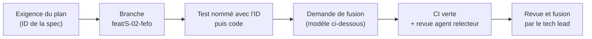

# COLLABORATION.md — comment humains et agents IA travaillent ensemble

Objectif : livrer vite sans perdre le contrôle. Le processus tient en une page, exprès.

## 1. Rôles

| Rôle | Qui | Décide | Ne fait pas |
|---|---|---|---|
| Porteur du projet | Humain | Priorités, périmètre, partenaires, budget | Fusionner du code non revu |
| Tech lead | Humain | Architecture, ADR, fusions sur la branche principale, mises en production | Laisser passer une CI rouge |
| Pharmacien référent | Humain | Règles métier, criticité, recette, questions réglementaires | — |
| Agent bâtisseur | Qoder (agent IA) | Comment coder une exigence de la spécification | Toucher aux règles de `GUARDRAILS.md` sans accord |
| Agent relecteur | Second agent IA ou second modèle, sans contexte de l'auteur | Commentaires de revue, tests manquants | Approuver seul une fusion |

## 2. Boucle de travail



- **Une demande de fusion = un groupe d'exigences**, moins de 600 lignes modifiées si possible.
- **Branche principale protégée** : fusion uniquement par le tech lead, CI verte obligatoire.
- **Commits** au format Conventional Commits : `feat(sales): V-04 vente atomique`, `fix(ledger): …`, `test(rbac): …`.

## 3. Modèle de demande de fusion

```
## Exigences
S-02, S-03

## Ce qui change
- 2 ou 3 lignes

## Hypothèses
- Ce que j'ai dû interpréter dans la spec, et le choix fait

## Tests
- Les noms des tests ajoutés ; la sortie de `npm test` résumée

## Points de vigilance pour la revue
- Ce qui mérite un second regard (sécurité, concurrence, migration)
```

## 4. Décisions

- Une décision qui change la pile, le schéma, le journal, la cryptographie ou un garde-fou = **une ADR** de 10 lignes dans `annexes/H-adr.md` (contexte, décision, conséquences). Le tech lead la valide.
- Tout le reste se décide dans la demande de fusion, sous « Hypothèses ». Pas de réunion, pas de document en plus.

## 5. Questions et blocages

- L'agent pose une question **seulement** dans les cas de `GUARDRAILS.md`, section 5. Il continue sur une autre exigence en attendant.
- Les questions ouvertes sont listées en tête de la demande de fusion, ou dans `docs/QUESTIONS.md` s'il n'y en a pas.
- Le tech lead répond dans la journée. Une réponse devient une ligne de la spécification, ou une ADR.

## 6. Avancement

- Le tableau d'avancement est la liste des exigences du plan (`docs/07-plan-14-jours.md`), avec l'état : à faire, en cours, en revue, terminé.
- Chaque soir, le tech lead met le tableau à jour et note les risques du lendemain. C'est le seul rapport demandé.

## 7. Qualité sans lourdeur

- La CI fait le travail de contrôle : typage, lint, tests, audit des dépendances, détection de secrets, SBOM.
- La revue humaine se concentre sur : la sûreté du patient, l'intégrité des données, la sécurité, la lisibilité.
- Ce qui n'est pas automatisé n'est pas exigé des agents.
