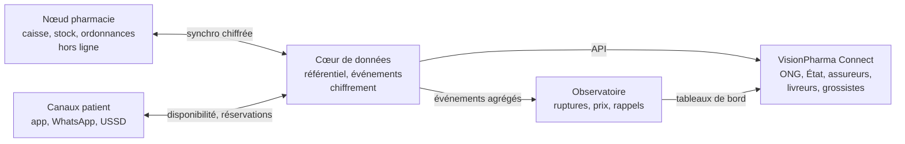
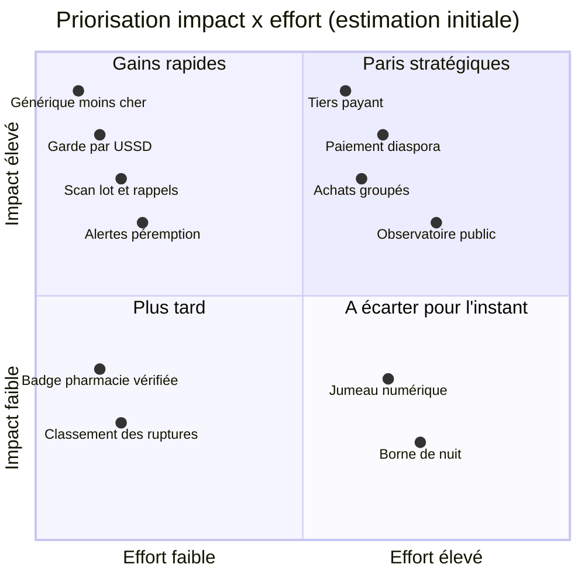
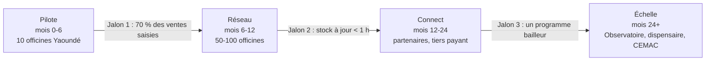

<!-- VisionPharma · documentation projet · v3.1 · 2026-10-26 -->

# Partie I — Vision et stratégie

Le diagnostic, les modèles étudiés, le produit réimaginé, le portail partenaires, le brainstorming, le modèle économique et la feuille de route.

## 1. Résumé exécutif

VisionPharma doit devenir l'infrastructure de données du médicament au Cameroun, en commençant par le logiciel de pharmacie, pas par une énième app patient.

**Pourquoi maintenant.** Plus d'un quart du marché passe par la rue, le pays importe plus de 90 % de ses médicaments et les ruptures sont chroniques. Trois leviers s'ouvrent en 2026 : le Plan stratégique national de santé numérique 2026-2030, la Couverture santé universelle qui cherche ses outils, et la loi sur les données personnelles entrée en vigueur le 23 juin 2026.

**Ce que la recherche change.** Les apps « trouver mon médicament » existent déjà au Cameroun (UrPharm, ACRAMED, OrdoPack). Une app de plus n'est pas défendable. Ce qui manque, c'est la donnée de stock fiable en temps réel, et elle ne vient que d'un logiciel utilisé chaque jour en caisse. mPharma, Maisha Meds et RxAll ont tous bâti leur réseau sur ce socle.

**La thèse en quatre couches, plus une porte d'entrée :**

1.  **Le nœud pharmacie** : caisse, stock et ordonnances, offline-first, multi-poste. C'est le cheval de Troie.

2.  **Le cœur de données** : référentiel médicament unique, traçabilité des lots, chiffrement, hébergement conforme.

3.  **Les canaux patient** : app, WhatsApp et USSD. On réserve, on ne vend pas.

4.  **L'Observatoire** : ruptures, prix, rappels de lots et signaux épidémiologiques agrégés.

5.  **Le Portail Entreprise (VisionPharma Connect)** : API et espaces dédiés pour ONG, État, livreurs, assureurs, grossistes et télémédecine.

**Premier pas proposé :** un pilote de 10 officines à Yaoundé, mesuré sur un seul chiffre : la part des ventes saisies dans le logiciel chaque jour.

## 2. État des lieux : Afrique et Cameroun

Le problème n'est pas l'absence de médicaments, c'est un marché opaque où le circuit illicite comble les trous du circuit officiel. Les chiffres ci-dessous viennent de sources publiques ; certains sont anciens et seront à actualiser en phase terrain.

### 2.1 Afrique subsaharienne

| **Indicateur**                                                                              | **Chiffre**        | **Source**                                                                                                                     |
|---------------------------------------------------------------------------------------------|--------------------|--------------------------------------------------------------------------------------------------------------------------------|
| Produits médicaux sous-standard ou falsifiés dans les pays à revenu faible et intermédiaire | environ 1 sur 10   | [OMS, 2017](https://www.africanews.com/2017/11/29/majority-of-medicines-in-developing-countries-substandard-or-falsified-who/) |
| Part des signalements reçus par l'OMS venant d'Afrique subsaharienne                        | 42 %               | [OMS, 2017](https://www.africanews.com/2017/11/29/majority-of-medicines-in-developing-countries-substandard-or-falsified-who/) |
| Décès annuels liés aux antipaludiques falsifiés ou sous-standard                            | jusqu'à 267 000    | [ONUDC, 2023](https://news.un.org/en/story/2023/02/1133062)                                                                    |
| Décès annuels liés aux antibiotiques falsifiés contre la pneumonie infantile                | jusqu'à 169 271    | [ONUDC, 2023](https://news.un.org/en/story/2023/02/1133062)                                                                    |
| Produits médicaux saisis en Afrique de l'Ouest, 2017-2021                                   | plus de 605 tonnes | [ONUDC, 2023](https://news.un.org/en/story/2023/02/1133062)                                                                    |

L'ONUDC souligne que les circuits légaux et illégaux sont liés : des produits illicites finissent dans des officines agréées. Au niveau continental, l'[Agence africaine du médicament](https://www.ema.europa.eu/es/partners-networks/international-activities/multilateral-coalitions-initiatives/african-medicines-agency-african-union) prend le relais du programme d'harmonisation réglementaire mené de 2009 à 2025.

### 2.2 Cameroun

| **Indicateur**                                           | **Chiffre**                                                                                                 | **Source**                                                                                                                                                                                               |
|----------------------------------------------------------|-------------------------------------------------------------------------------------------------------------|----------------------------------------------------------------------------------------------------------------------------------------------------------------------------------------------------------|
| Part du marché passant par les « médicaments de la rue » | un peu plus de 25 %, dont 40 % issus de la contrebande                                                      | [Ordre national des pharmaciens](https://www.camer.be/75794/11:1/cameroon-cameroun-plus-de-25-des-medicaments-issus-des-circuits-illicites.html)                                                         |
| Valeur des faux médicaments détruits en 2021             | près de 3 milliards FCFA, 206 saisies                                                                       | [Minsanté via Allodocteurs](https://www.allodocteurs.fr/le-cameroun-toujours-victime-du-trafic-de-faux-medicaments-43993.html)                                                                           |
| Dépendance aux importations                              | plus de 90 % des besoins ; marché de plus de 125 milliards FCFA, dont environ 8 pour les producteurs locaux | [Financial Afrik, 2023](https://www.financialafrik.com/2023/09/07/cameroun-une-dette-fiscale-dun-milliard-de-fcfa-plombe-la-production-pharmaceutique/)                                                  |
| Impayés de la CENAME fin 2021                            | 14,6 milliards FCFA ; livraisons étrangères suspendues                                                      | [EcoMatin](https://ecomatin.net/cameroun-letat-et-les-particuliers-enfoncent-la-cename-dans-la-crise-avec-plus-de-14-milliards-de-dettes)                                                                |
| Ordonnance obligatoire pour tout médicament              | depuis le 1er juillet 2024                                                                                  | [Alwihda](https://www.alwihdainfo.com/cameroun-mise-en-oeuvre-de-la-nouvelle-reglementation-relative-aux-ordonnances-medicales-a133507/)                                                                 |
| Couverture santé universelle                             | 318 milliards FCFA mobilisés en 3 ans, résultats jugés mitigés                                              | [EcoMatin, 2026](https://ecomatin.net/couverture-sante-universelle-le-cameroun-a-depense-318-milliards-fcfa-en-trois-ans-pour-des-resultats-mitiges)                                                     |
| Plan stratégique national de santé numérique 2026-2030   | lancé le 4 mars 2026, budget de 29 milliards FCFA                                                           | [Digital Business Africa](https://www.digitalbusiness.africa/les-10%e1%b5%89-journees-camerounaises-de-sante-numerique-pour-lavancement-de-la-couverture-sante-universelle/)                             |
| Loi n° 2024/017 sur les données personnelles             | en vigueur le 23 juin 2026 ; amendes jusqu'à 1 milliard FCFA                                                | [Droit Médias Finance](https://droitmediasfinance.com/index.php/actualites/droit-tech-fintech/1297-cameroun-la-loi-sur-la-protection-des-donnees-a-caractere-personnel-entre-en-vigueur-ce-23-juin-2026) |
| Délais de paiement de l'État à ses prestataires          | plus de 200 jours en 2025                                                                                   | [Financial Afrik, 2026](https://www.financialafrik.com/2026/02/26/cameroun-les-retards-de-paiement-depassent-200-jours-en-2025/)                                                                         |
| Téléphone / smartphone / Internet                        | environ 95 % / 40 % / 34 % (estimation ancienne)                                                            | [Stop TB Partnership](https://tbassessment.stoptb.org/cameroon.html)                                                                                                                                     |

*Une estimation de l'Ordre de 2021 avance même que la moitié des médicaments en circulation seraient faux ou de mauvaise qualité ; ce chiffre est à manier avec prudence.*

### 2.3 Ce que ça implique pour VisionPharma

- **Le prix est la première porte de sortie vers la rue.** Afficher les prix et proposer le générique moins cher compte autant que la lutte anti-contrefaçon.

- **Le smartphone n'est pas universel.** WhatsApp et USSD sont des canaux de premier rang, pas des options.

- **Les données de santé sont désormais très encadrées.** Hébergement à l'étranger soumis à autorisation préalable, chiffrement et délégué à la protection des données dès le départ.

- **Vendre à l'État est risqué en trésorerie.** Les contrats publics doivent être cofinancés par des bailleurs ou payés d'avance.

## 3. Ce que font les autres en Afrique

Les acteurs qui ont passé l'échelle partagent un point commun : ils contrôlent le logiciel ou le stock de la pharmacie, pas seulement l'interface patient.

| **Acteur**                                                                                                                                                                                                     | **Pays**                                     | **Ce qu'ils font**                                                                                                | **Repères publics**                                                                                                                                                    | **Leçon pour VisionPharma**                                                                                                |
|----------------------------------------------------------------------------------------------------------------------------------------------------------------------------------------------------------------|----------------------------------------------|-------------------------------------------------------------------------------------------------------------------|------------------------------------------------------------------------------------------------------------------------------------------------------------------------|----------------------------------------------------------------------------------------------------------------------------|
| [mPharma](https://allafrica.com/stories/202511060552.html)                                                                                                                                                     | Ghana, Afrique de l'Ouest et de l'Est        | Logiciel et gestion de stock des pharmacies, puis franchise Mutti avec consultations et financement               | Plus de 400 000 membres Mutti fin 2024 ; plus de 75 % des membres sans rupture d'essentiels ; entrée au Togo et au Bénin                                               | Le logiciel mène à la chaîne d'approvisionnement, puis à la marque. Concurrent ou partenaire possible en zone francophone. |
| [Maisha Meds](https://jobs.ffwd.org/companies/maisha-meds/jobs/69136889-senior-product-manager-ai-pos)                                                                                                         | Kenya, Tanzanie, Ouganda, Nigeria, Zambie    | Caisse Android gratuite pour pharmacies et cliniques, prévisions et commandes, subventions reversées aux patients | 25 millions de visites patients par an ; plus d'un million de remboursements contrôlés ; financé notamment par la fondation Gates et l'USAID                           | Logiciel gratuit + programmes de bailleurs = modèle direct pour notre portail ONG.                                         |
| [RxAll](https://innovationlabs.harvard.edu/articles/how-rxall-is-combatting-fake-drugs-and-improving-healthcare-access-in-africa)                                                                              | Nigeria, Kenya, Ouganda                      | Scanner moléculaire à IA, puis marketplace et téléconsultation                                                    | Plus de 5 000 pharmaciens utilisateurs                                                                                                                                 | L'authentification ouvre la porte, la plateforme fait le revenu. À intégrer en partenaire.                                 |
| [mPedigree](https://www.howwemadeitinafrica.com/p/how-mpedigree-built-a-business-by-combating-counterfeit-products) / [Sproxil](https://venturebeat.com/business/sproxil-takes-on-africas-drug-counterfeiters) | Ghana, Nigeria, Kenya                        | Code à gratter sur la boîte, vérifié par SMS gratuit                                                              | Accord Orange–mPedigree de 2011 visant notamment le [Cameroun](https://www.mobileworldlive.com/latest-stories/pan-african-operator-backs-drug-authentication-service/) | Utile seulement si les fabricants étiquettent et si l'usage devient une habitude.                                          |
| [Zipline](https://en.wikipedia.org/wiki/Zipline_(drone_delivery_company))                                                                                                                                      | Rwanda, Ghana, Nigeria, Kenya, Côte d'Ivoire | Livraison par drone vers les formations sanitaires, sur contrats publics                                          | 2 millions de livraisons commerciales atteintes en janvier 2026                                                                                                        | Le dernier kilomètre est un partenaire, branché par API.                                                                   |
| [Waspito](https://techpoint.africa/news/cameroonian-healthtech-raises-additional-seed/)                                                                                                                        | Cameroun, Côte d'Ivoire                      | Téléconsultation, livraison de médicaments, prélèvements à domicile                                               | Extension de seed de 2,5 M\$ ; expansion vers le Sénégal et le Gabon                                                                                                   | Partenaire naturel : leurs ordonnances électroniques vers nos pharmacies.                                                  |
| [UrPharm](https://ecomatin.net/la-start-up-urpharm-inc-lance-une-application-de-geolocalisation-des-pharmacies-et-medicaments)                                                                                 | Cameroun                                     | Localisation d'un médicament en stock, prix, livraison                                                            | 56 pharmacies dans 4 villes au lancement                                                                                                                               | Le besoin patient est prouvé ; la couverture dépend de la donnée de stock.                                                 |
| [ACRAMED](https://www.allodocteurs.fr/au-cameroun-une-application-trouve-les-pharmacies-sures-40415.html)                                                                                                      | Cameroun                                     | Trouver une pharmacie sûre qui a le médicament ; pas de vente                                                     | Plus de 500 pharmacies et 10 000 médicaments référencés                                                                                                                | Créée par une pharmacienne : l'adhésion de l'Ordre est un atout.                                                           |
| [OrdoPack](https://mwm.ai/apps/ordopack/6760606131)                                                                                                                                                            | Douala                                       | Commande, envoi d'ordonnance, livraison ou retrait, Mobile Money                                                  | Disponible à Douala, extension annoncée                                                                                                                                | Le parcours patient complet existe déjà ; il faut se différencier ailleurs.                                                |

Le statut actuel des acteurs camerounais n'a pas été vérifié sur le terrain ; c'est la première chose à faire avant le pilote. Aucun ne semble fournir le logiciel de caisse des officines, et c'est l'espace que VisionPharma doit prendre.

## 4. Ce que font les pays développés

Dans les systèmes matures, c'est le logiciel d'officine qui sert de réseau d'alerte national, et ce n'est pas le patient qui paie la plateforme.

| **Modèle**                                                                                                                                                                                                                         | **Comment ça marche**                                                                                                                                                                                                                                                                                                                            | **Ce qu'on copie**                                                                             | **Ce qu'on adapte**                                                                                                   |
|------------------------------------------------------------------------------------------------------------------------------------------------------------------------------------------------------------------------------------|--------------------------------------------------------------------------------------------------------------------------------------------------------------------------------------------------------------------------------------------------------------------------------------------------------------------------------------------------|------------------------------------------------------------------------------------------------|-----------------------------------------------------------------------------------------------------------------------|
| [Dossier Pharmaceutique](https://www.ordre.pharmacien.fr/le-dossier-pharmaceutique/les-services-du-dp2) (France, Ordre des pharmaciens)                                                                                            | Le logiciel de l'officine déclare automatiquement une rupture quand un produit n'est pas livré pendant [72 heures](https://www.lequotidiendupharmacien.fr/exercice-pro/politique-de-sante/200-000-signalements-en-21-mois). Les rappels de lots bloquent la dispensation. Une alerte sanitaire atteint toutes les officines en quelques minutes. | La rupture détectée par la caisse, sans saisie manuelle. Le rappel de lot qui bloque la vente. | Le pilotage par l'Ordre : au Cameroun, il faut un partenariat avec l'Ordre et la DPML plutôt qu'un service imposé.    |
| [Système européen de vérification](https://efpia.eu/news-events/the-efpia-view/statements-press-releases/medicines-verification-system-goes-live-across-eu-to-better-protect-patients-from-falsified-medicines/) (UE, depuis 2019) | Chaque boîte porte un identifiant unique dans un code 2D. Le pharmacien le scanne et le « désactive » avant de délivrer. Le système relie environ 140 000 pharmacies, financé par les fabricants.                                                                                                                                                | La vérification au point de délivrance, payée par l'industrie.                                 | Pas de sérialisation obligatoire au Cameroun : commencer par le lot et la date de péremption, scannés à la réception. |
| [GoodRx](https://vator.tv/2021-10-01-how-does-goodrx-make-money/) (États-Unis)                                                                                                                                                     | Comparateur gratuit des prix d'un médicament selon les pharmacies ; GoodRx est rémunéré par les gestionnaires de prestations pharmaceutiques à chaque ordonnance servie.                                                                                                                                                                         | La transparence des prix comme produit d'appel, gratuite pour le patient.                      | Pas de gestionnaires de prestations ici : le payeur sera le grossiste, l'assureur ou le bailleur.                     |

Le modèle africain le plus proche de l'Europe est le Nigeria : sa [stratégie nationale de traçabilité](https://www.visiott.com/info-point/regulations/nigeria-regulations/) visait une traçabilité GS1 de tous les produits pharmaceutiques fin 2024. Le Cameroun n'en est pas là, mais concevoir VisionPharma compatible GS1 dès le départ évite une refonte.

## 5. Innovations à surveiller

La règle : construire ce qui crée notre donnée, s'intégrer à tout le reste.

| **Innovation**                                    | **Où en est-on**                                                                                                                                                                                               | **Décision VisionPharma**                                                                                                            |
|---------------------------------------------------|----------------------------------------------------------------------------------------------------------------------------------------------------------------------------------------------------------------|--------------------------------------------------------------------------------------------------------------------------------------|
| Lecture d'ordonnances par IA                      | Les ordonnances manuscrites restent nettement moins bien lues que les imprimées : environ 85 % contre 95 % dans une [étude de 2024](https://imagetotable.ai/blog/prescription-extraction-accuracy-drug-safety) | **Construire**, avec validation obligatoire par le pharmacien. L'IA pré-remplit, l'humain confirme.                                  |
| Prévision de la demande et commande automatique   | Déjà au cœur de [Maisha Meds](https://causes.benevity.org/causes/840-814618222), combinée au crédit fournisseur                                                                                                | **Construire** : c'est la valeur immédiate pour le pharmacien.                                                                       |
| Traçabilité GS1 (lots, code 2D)                   | Stratégie nationale au Nigeria, pilotes sur les vaccins ([NAFDAC](https://annales.sum.edu.pl/Traceability-for-strengthening-supply-chain-systems-and-enhancing-real-time-visibility,195199,0,1.html))          | **Concevoir compatible** dès le départ ; scanner lot et péremption à la réception.                                                   |
| Authentification physique par spectrométrie et IA | [RxAll](https://technext.ng/2020/09/21/nigerian-healthtech-startup-rxall-secures-n135m-investment-from-founders-factory-africa/) déploie des scanners auprès de régulateurs et pharmacies                      | **Intégrer** en partenaire pour les contrôles ciblés.                                                                                |
| Codes à gratter vérifiés par SMS                  | [mPedigree et Sproxil](https://www.mobileworldlive.com/latest-stories/pan-african-operator-backs-drug-authentication-service/), financés par les fabricants                                                    | **Intégrer** si des laboratoires présents au Cameroun l'utilisent.                                                                   |
| Interopérabilité FHIR et DHIS2                    | Le Cameroun utilise déjà [DHIS2](https://tbassessment.stoptb.org/cameroon.html) au Centre d'information sanitaire du ministère                                                                                 | **Exporter** nos agrégats en FHIR vers DHIS2 : c'est la langue de l'État et des ONG.                                                 |
| Livraison par drone et dernier kilomètre          | [Zipline](https://en.wikipedia.org/wiki/Zipline_(drone_delivery_company)) opère dans cinq pays africains sur contrats publics                                                                                  | **Brancher** par le portail, jamais opérer nous-mêmes.                                                                               |
| Assistants vocaux multilingues                    | Modèles de langage capables de comprendre français, anglais et pidgin                                                                                                                                          | **Construire** une couche fine sur un modèle existant, limitée à l'information (disponibilité, prix, rappels), sans conseil médical. |
| Synchronisation offline-first                     | Bases locales qui se synchronisent quand le réseau revient                                                                                                                                                     | **Construire** : c'est la condition de survie en officine.                                                                           |

## 6. Le produit réimaginé

> **VisionPharma est le réseau qui sait, en temps réel, quel médicament est disponible, où, à quel prix, et s'il est authentique.**

*Figure 1 — Architecture : quatre couches et le portail partenaires*

La pharmacie produit la donnée ; le cœur la vérifie et la protège ; patients, partenaires et Observatoire n'en voient que ce que leurs droits permettent.

### 6.1 Le nœud pharmacie (le cheval de Troie)

- **Caisse multi-poste** sur le réseau local de l'officine, qui fonctionne sans Internet ; synchronisation chiffrée dès le retour du réseau.

- **Stock vivant** : réception par scan (lot, péremption), inventaire tournant, alertes de péremption à 90, 60 et 30 jours.

- **Ordonnances** : photo, lecture par IA, validation par le pharmacien, archivage. Cela répond directement à l'obligation d'ordonnance de 2024.

- **Commande intelligente** : suggestion de commande aux grossistes à partir des ventes et des délais.

- **Rappels et ruptures façon Dossier Pharmaceutique** : un lot rappelé est bloqué en caisse ; une rupture de 72 heures est signalée automatiquement.

- **Tableau de bord du titulaire** : marge, rotation, pertes, comparaison anonyme avec le réseau.

### 6.2 Le cœur de données

- **Référentiel médicament unique** : DCI, dosage, forme, statut d'autorisation, équivalences génériques, codes GS1 quand ils existent. C'est l'actif le plus précieux du projet.

- **Journal d'événements** : chaque vente, réception et rupture devient un événement horodaté, ce qui permet la synchronisation, l'audit et l'Observatoire.

- **Sécurité** : chiffrement au repos et en transit, clés par officine, hébergement au Cameroun ou à l'étranger avec l'autorisation préalable exigée par la loi, journal d'accès.

- **Reprise après panne** : le nœud local est le premier secours de l'officine ; le cloud répliqué restaure le nœud. Le « serveur crypté avec backup » devient une architecture hybride.

### 6.3 Les canaux patient

- **App, WhatsApp, USSD** : disponibilité et prix autour de moi, pharmacie de garde, photo d'ordonnance, réservation avec acompte Mobile Money.

- **Générique moins cher proposé**, validé par le pharmacien.

- **Carnet familial et rappels de prise**, rappels de lots ciblés sur les acheteurs concernés, avec leur consentement.

- **On réserve, on ne vend pas** : la délivrance reste un acte du pharmacien.

### 6.4 L'Observatoire

- Carte des ruptures et des prix, signaux épidémiologiques (une hausse brutale des antipaludiques dans un district), suivi des rappels.

- Données agrégées et anonymisées uniquement, avec un seuil minimal par zone pour éviter toute réidentification.

### 6.5 Le module dispensaire (plus tard)

Une version allégée du nœud pharmacie, sur le même cœur, pour les petits centres de santé : stock, consommation, commandes à la CENAME ou aux fonds régionaux.

### 6.6 Règles d'or de l'IA

1.  L'IA ne diagnostique jamais et ne prescrit jamais.

2.  Toute suggestion qui touche à la délivrance est validée par un pharmacien.

3.  Chaque suggestion est tracée : qui l'a acceptée, quand, sur quelle base.

## 7. Portail Entreprise : VisionPharma Connect

VisionPharma Connect est une seule porte d'entrée, un portail web et une API, par laquelle chaque organisation se branche au réseau avec des droits taillés pour son métier. C'est aussi là que se fait l'essentiel du revenu.

### 7.1 Qui se connecte, pour quoi faire

| **Partenaire**                                                                 | **Ce qu'il obtient**                                                                                                                      | **Ce qu'il apporte**                                                       | **Comment il se branche**                                                 | **Comment il paie**                                        |
|--------------------------------------------------------------------------------|-------------------------------------------------------------------------------------------------------------------------------------------|----------------------------------------------------------------------------|---------------------------------------------------------------------------|------------------------------------------------------------|
| **ONG et programmes de santé** (paludisme, VIH, tuberculose, santé maternelle) | Bons et subventions délivrés dans les pharmacies du réseau, suivi de la dispensation, stock des produits du programme, alertes de rupture | Financement des subventions, produits, exigences de reporting              | Espace programme sur le portail, API, export FHIR vers DHIS2              | Frais de gestion par programme ou par bon traité           |
| **État** (Minsanté, DPML, LANACOME, CSU)                                       | Observatoire des ruptures et des prix, diffusion des rappels de lots, signaux épidémiologiques, statut des officines                      | Référentiel des autorisations, listes de rappels, validation des agréments | Tableau de bord en lecture, flux FHIR et DHIS2, canal d'alerte descendant | Convention cofinancée par un bailleur, payée d'avance      |
| **Livreurs** (Yango, Gozem, Glovo, coursiers locaux)                           | Commandes prêtes à enlever, adresse, code de remise, statut en temps réel                                                                 | Flotte, suivi GPS, preuve de livraison                                     | API de dispatch et webhooks                                               | Frais par course, partagés selon un barème                 |
| **Assureurs, mutuelles, CSU**                                                  | Tiers payant électronique, vérification des droits en caisse, factures structurées, détection d'anomalies                                 | Règles de couverture, listes d'assurés                                     | API de vérification et de facturation                                     | Frais par dossier traité                                   |
| **Grossistes-répartiteurs et laboratoires**                                    | Commandes électroniques, signalement des ruptures, diffusion des rappels, ventes agrégées par zone                                        | Catalogue, prix, disponibilités, avis de rappel                            | Intégration EDI ou API, portail fournisseur                               | Commission sur commande et abonnement aux données agrégées |
| **Télémédecine** (Waspito, MonDocteur237)                                      | Envoi de l'ordonnance électronique à la pharmacie choisie par le patient, statut de délivrance                                            | Ordonnances structurées et signées                                         | API d'ordonnance électronique                                             | Frais par ordonnance transmise                             |
| **Employeurs**                                                                 | Prise en charge pharmacie des salariés, budget et justificatifs                                                                           | Budget santé                                                               | Espace entreprise sur le portail                                          | Abonnement par salarié                                     |

### 7.2 Règles du jeu pour la livraison

La livraison est le point le plus sensible juridiquement : la loi de 1990 interdit la vente de médicaments sur la voie publique, et la délivrance reste un acte pharmaceutique.

- La commande est préparée, scellée et validée par le pharmacien avant tout enlèvement.

- Le livreur transporte un colis scellé, sans accès au contenu ni à l'ordonnance.

- Les produits de la chaîne du froid et les produits sensibles sont exclus au départ.

- Le patient confirme la remise par un code unique.

- **Question ouverte :** faire valider ce schéma par l'Ordre national des pharmaciens et la DPML avant le lancement.

### 7.3 Ce que l'API garantit

- **Accès** : OAuth2 par organisation, droits par périmètre (lecture des ruptures, envoi d'ordonnances, dispatch, facturation).

- **Événements** : webhooks signés, clés d'idempotence, versionnage de l'API, limites de débit par partenaire.

- **Données** : minimisation par défaut. Un livreur ne voit jamais un nom de médicament ; un ministère ne voit que des agrégats au-dessus d'un seuil.

- **Consentement** : registre des consentements patient, révocable depuis l'app ou WhatsApp.

- **Traçabilité** : journal d'audit consultable par chaque partenaire sur ses propres accès.

- **Bac à sable** : jeu de données fictif complet pour développer et tester sans toucher au réel.

### 7.4 Parcours d'un nouveau partenaire

1.  Candidature sur le portail et vérification de l'organisation.

2.  Signature de la convention et de l'accord de traitement des données.

3.  Accès au bac à sable, documentation et exemples de code.

4.  Recette : scénarios obligatoires validés par l'équipe VisionPharma.

5.  Passage en production avec des droits limités, élargis après 30 jours sans incident.

## 8. Séances de brainstorming

Un premier tour de brainstorming en trois temps a produit les idées ci-dessous, à confronter au terrain, suivies d'un kit pour les rejouer avec l'équipe, des pharmaciens et des patients.

### 8.1 Séance 1 : « Comment pourrions-nous… »

#### …aider une patiente sans smartphone à trouver son médicament à 22 h ?

- Code USSD qui renvoie la pharmacie de garde la plus proche ayant le produit.

- Note vocale WhatsApp : elle dit le nom du médicament, elle reçoit l'adresse et le prix.

- Affiche QR et numéro court dans chaque pharmacie du réseau.

#### …rendre le vrai médicament moins cher que celui de la rue ?

- Générique moins cher proposé automatiquement à chaque recherche.

- Achats groupés entre pharmacies du réseau, sur le modèle d'une centrale virtuelle.

- Abonnement maladies chroniques : prix fixe mensuel, rappel de renouvellement.

- Paiement fractionné en Mobile Money.

- Tontine santé et épargne santé, en pont avec KÓMBE.

- La diaspora paie directement le traitement de ses parents auprès de la pharmacie, en pont avec KÓMBE Send.

#### …faire du pharmacien un acteur engagé du réseau ?

- Version de base du logiciel gratuite, modules avancés payants.

- Bourse d'échange des produits proches de la péremption entre pharmacies du réseau.

- Crédit fournisseur accordé sur la base de l'historique de ventes.

- Classement anonyme : « votre taux de rupture comparé à votre quartier ».

#### …battre la contrefaçon sans scanner coûteux ?

- Réception par scan du lot et de la péremption, croisée avec la liste des rappels.

- Badge « pharmacie vérifiée » visible dans l'app, retiré automatiquement si l'agrément tombe.

- Signalement patient par photo de la boîte, transmis au LANACOME.

### 8.2 Séance 2 : brainstorming inversé, « Comment faire échouer VisionPharma ? »

| **Comment échouer**                                     | **Parade**                                                                                       |
|---------------------------------------------------------|--------------------------------------------------------------------------------------------------|
| Les pharmaciens ne saisissent pas leurs ventes          | Logiciel plus rapide que le cahier, saisie par scan, valeur visible dès la première semaine      |
| L'app patient affiche des stocks faux                   | N'afficher que les officines synchronisées depuis moins d'une heure ; sinon « à confirmer »      |
| Une fuite de données de santé                           | Chiffrement par officine, minimisation, audit, délégué à la protection des données dès le pilote |
| Conflit avec l'Ordre des pharmaciens                    | Associer l'Ordre dès la conception ; ne jamais vendre directement                                |
| Dépendance à un seul payeur public                      | Revenus diversifiés : pharmacies, grossistes, bailleurs, assureurs                               |
| Une coupure d'électricité ou de réseau bloque la caisse | Nœud local, mode dégradé sur tablette avec batterie                                              |

### 8.3 Séance 3 : idées hors cadre

- **Jumeau numérique du stock national** : simuler l'effet d'une rupture chez un grossiste sur chaque district.

- **Pharmacie de garde sponsorisée** par un assureur ou un opérateur mobile.

- **Borne de retrait sécurisée** pour les commandes réservées, dans les zones sans pharmacie ouverte la nuit.

- **Score de confiance du médicament** affiché au patient : lot vérifié, pharmacie agréée, chaîne d'approvisionnement connue.

### 8.4 Priorisation

*Figure 2 — Priorisation impact × effort de douze idées*

Les quatre gains rapides entrent dans le pilote ; le tiers payant et le pont diaspora sont les deux paris à préparer pendant la phase Réseau.

### 8.5 Kit pour animer les séances

| **Séance**     | **Durée** | **Qui**                                                                                      | **Déroulé**                                                                                          | **Ce qui en sort**                                              |
|----------------|-----------|----------------------------------------------------------------------------------------------|------------------------------------------------------------------------------------------------------|-----------------------------------------------------------------|
| 1\. Comprendre | 90 min    | 2 titulaires d'officine, 1 préparateur, 2 patients dont 1 malade chronique, l'équipe produit | Parcours d'une ordonnance de la consultation à la prise ; noter chaque blocage sur un post-it        | Les 10 blocages les plus cités, avec une citation réelle chacun |
| 2\. Imaginer   | 90 min    | Même groupe + 1 représentant d'ONG + 1 développeur                                           | Questions « Comment pourrions-nous… », 8 idées en 8 minutes par personne, puis brainstorming inversé | 40 à 60 idées brutes                                            |
| 3\. Choisir    | 60 min    | Équipe fondatrice + 1 pharmacien                                                             | Placement sur la matrice impact × effort, vote à 3 gommettes, une fiche test par idée retenue        | 3 idées à tester dans le pilote, chacune avec son indicateur    |

Règles : pas de critique en phase d'idéation, un post-it par idée, un pharmacien a toujours le dernier mot sur ce qui touche à la délivrance.

## 9. Modèle économique

Le patient ne paie jamais la plateforme ; ce sont les officines, les fournisseurs et les payeurs qui la financent, comme pour GoodRx et le système européen de vérification.

| **Source de revenu**                   | **Qui paie**                          | **Base de calcul**                                   | **À partir de**                |
|----------------------------------------|---------------------------------------|------------------------------------------------------|--------------------------------|
| Abonnement logiciel                    | Officines                             | Par poste et par mois ; version de base gratuite     | Pilote (gratuit), puis phase 1 |
| Commission sur commandes électroniques | Grossistes-répartiteurs               | Pourcentage de la commande passée depuis le logiciel | Phase 1                        |
| Tiers payant électronique              | Assureurs, mutuelles, CSU             | Par dossier traité                                   | Phase 2                        |
| Gestion de programmes                  | ONG et bailleurs                      | Par programme ou par bon délivré                     | Phase 2                        |
| Frais de livraison                     | Patient, via le livreur               | Par course, partagés avec le livreur                 | Phase 2                        |
| Ordonnances électroniques              | Plateformes de télémédecine           | Par ordonnance transmise                             | Phase 2                        |
| Données agrégées de l'Observatoire     | Laboratoires, institutions, bailleurs | Abonnement annuel                                    | Phase 3                        |

Les montants restent à fixer pendant le pilote, à partir de ce que les pharmaciens paient aujourd'hui pour leurs logiciels et de ce qu'une heure de leur temps vaut. Aucun chiffre n'est avancé ici sans cette mesure.

## 10. Feuille de route

On ne passe à la phase suivante que lorsque le jalon est atteint ; les durées sont des ordres de grandeur à confirmer après le pilote.

*Figure 3 — Feuille de route : quatre phases, trois jalons*

| **Phase** | **Période**     | **Contenu**                                                                                      | **Jalon de sortie**                 |
|-----------|-----------------|--------------------------------------------------------------------------------------------------|-------------------------------------|
| Pilote    | Mois 0 à 6      | 10 officines à Yaoundé, caisse offline-first, référentiel médicament, lecture d'ordonnances      | 70 % des ventes saisies chaque jour |
| Réseau    | Mois 6 à 12     | 50 à 100 officines, app, WhatsApp et USSD, commandes grossistes, ruptures et rappels             | Stock à jour en moins d'une heure   |
| Connect   | Mois 12 à 24    | Portail partenaires, tiers payant, programmes ONG, livraison encadrée, ordonnances électroniques | Un programme bailleur financé       |
| Échelle   | Mois 24 et plus | Observatoire, module dispensaire, Douala puis zone CEMAC                                         | —                                   |

Le premier jalon est le seul qui compte au départ : si les pharmaciens ne saisissent pas leurs ventes, rien d'autre ne fonctionne. Les seuils des jalons sont des propositions à valider avec l'équipe.

## 11. Risques et garde-fous

Le risque principal n'est pas technique : c'est que les pharmaciens n'adoptent pas l'outil au quotidien.

| **Risque**                                        | **Parade**                                                                                                                 |
|---------------------------------------------------|----------------------------------------------------------------------------------------------------------------------------|
| Adoption faible par les officines                 | Pilote co-conçu avec 10 titulaires ; logiciel de base gratuit ; un indicateur unique : part des ventes saisies chaque jour |
| Cadre réglementaire (vente, livraison, publicité) | Réserver sans vendre ; schéma de livraison validé par l'Ordre et la DPML avant lancement                                   |
| Protection des données de santé                   | Délégué à la protection des données, hébergement autorisé, chiffrement par officine, agrégats au-dessus d'un seuil         |
| Erreur de l'IA sur une ordonnance                 | Validation humaine obligatoire, traçabilité de chaque suggestion, IA cantonnée à l'aide                                    |
| Trésorerie liée aux contrats publics              | Conventions cofinancées par des bailleurs, paiement d'avance, pas plus d'un tiers du revenu venant de l'État               |
| Concurrence de mPharma ou d'apps locales          | Se placer sur le logiciel d'officine que les apps n'ont pas ; proposer des partenariats aux apps existantes via le portail |
| Qualité du référentiel médicament                 | Construire le référentiel avec la DPML et les grossistes, mises à jour versionnées et auditées                             |
