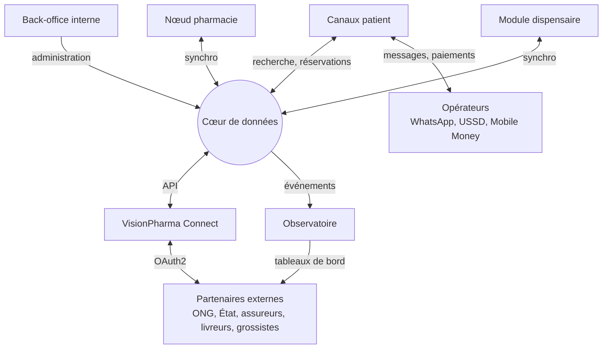
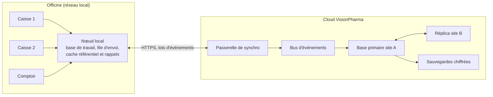
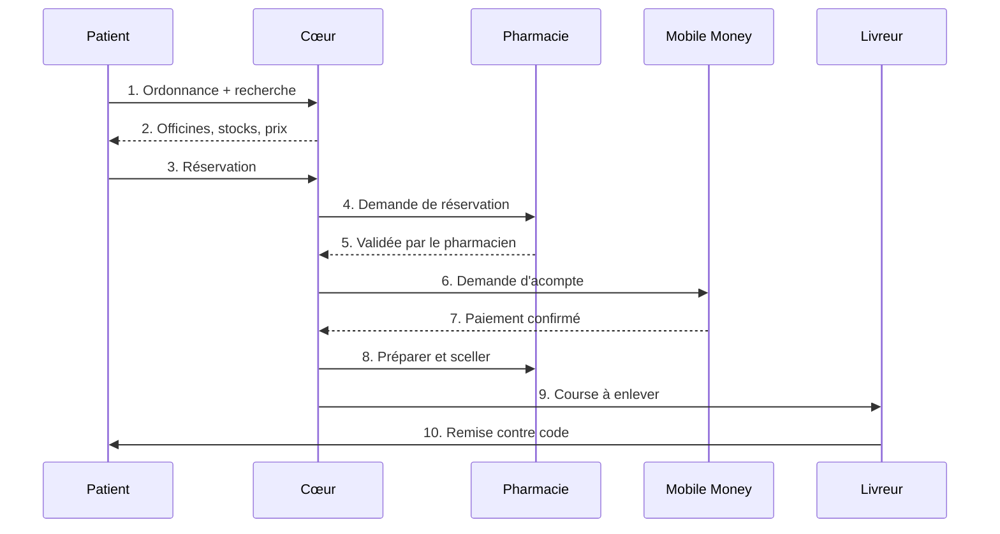

<!-- VisionPharma · documentation projet · v3.1 · 2026-10-26 -->

# Partie II — Spécifications des composants

Pour chaque composant : fonctionnalités, système, liaisons, données, sécurité et exigences, puis le découpage du MVP en lots.

## 12. Vue d'ensemble : composants et liaisons

VisionPharma compte huit composants construits par l'équipe et trois familles de systèmes externes, tous reliés par le cœur de données. Aucun composant n'accède directement à la base d'un autre.

*Figure 4 — Carte des composants et de leurs liaisons*

### 12.1 Les composants

| **Composant**                              | **Rôle**                                                     | **Utilisateurs**                                         | **Où il tourne**                                         | **Priorité**                      |
|--------------------------------------------|--------------------------------------------------------------|----------------------------------------------------------|----------------------------------------------------------|-----------------------------------|
| **Nœud pharmacie** (VisionPharma Officine) | Caisse, stock, ordonnances, commandes                        | Titulaires, pharmaciens, préparateurs, caissiers         | Mini-serveur dans l'officine, postes sur le réseau local | MVP                               |
| **Cœur de données**                        | Référentiel, identité, événements, synchronisation, sécurité | Tous les composants                                      | Cloud, deux sites                                        | MVP                               |
| **Canaux patient**                         | Recherche, réservation, rappels                              | Patients et familles                                     | WhatsApp, USSD, Android puis iOS                         | MVP (WhatsApp), V2 (app complète) |
| **Back-office interne**                    | Réseau, référentiel, support, qualité de l'IA                | Équipe VisionPharma                                      | Web, cloud                                               | MVP                               |
| **Observatoire**                           | Ruptures, prix, rappels, signaux épidémiologiques            | Équipe, État, ONG, laboratoires                          | Cloud analytique                                         | V2                                |
| **VisionPharma Connect**                   | Portail et API partenaires                                   | ONG, État, assureurs, livreurs, grossistes, télémédecine | Cloud                                                    | V2                                |
| **Module dispensaire**                     | Stock et consommation des centres de santé                   | Gestionnaires de dispensaires                            | Tablette ou PC                                           | V3                                |
| **Couche IA**                              | Lecture d'ordonnances, prévision, interactions, assistant    | Transverse                                               | Cloud, règles en cache sur le nœud                       | MVP partiel                       |

### 12.2 Principes d'architecture

1.  **Hors ligne d'abord.** Toute fonction qui touche à la vente marche sans réseau.

2.  **Les événements font foi.** Le stock est la somme des mouvements enregistrés ; il n'y a donc pas de conflit d'écriture entre postes ou entre officine et cloud.

3.  **Un seul référentiel médicament**, versionné, publié par le cœur, jamais modifié localement.

4.  **Des contrats publiés.** API versionnées et schémas d'événements documentés ; chaque composant ne parle qu'à travers eux.

5.  **Le minimum de données pour chaque destinataire.** Un livreur ne voit pas un nom de médicament ; un ministère ne voit que des agrégats.

6.  **Des standards ouverts.** FHIR pour les échanges de santé, GS1 pour l'identification des produits, OAuth2 et OpenID Connect pour l'identité.

## 13. Nœud pharmacie : VisionPharma Officine

Le nœud pharmacie est le logiciel de gestion d'officine : il doit être plus rapide que le cahier et que le logiciel actuel dès la première semaine, sinon rien d'autre ne fonctionne.

### 13.1 Rôles et droits

| **Rôle**           | **Peut**                                                                                | **Ne peut pas**                                    |
|--------------------|-----------------------------------------------------------------------------------------|----------------------------------------------------|
| Titulaire          | Tout : paramétrage, prix, droits des comptes, rapports financiers, accès du support     | —                                                  |
| Pharmacien adjoint | Valider les ordonnances, délivrer, réceptionner, inventorier, accepter les réservations | Modifier les prix ou les droits sans délégation    |
| Préparateur        | Préparer, réceptionner, vendre les produits sans ordonnance spécifique                  | Valider une ordonnance, annuler une vente clôturée |
| Caissier           | Encaisser, éditer une facture, ouvrir et fermer la caisse                               | Voir les marges, modifier le stock                 |

### 13.2 Fonctionnalités

| **Module**         | **Fonctions**                                                                                                                                                                | **Priorité**   |
|--------------------|------------------------------------------------------------------------------------------------------------------------------------------------------------------------------|----------------|
| Caisse             | Vente par scan ou recherche, plusieurs postes simultanés, paiement en espèces, Mobile Money, tiers payant ou crédit client, tickets et factures, retours, clôture de caisse  | MVP            |
| Ordonnances        | Photo ou scan, lecture par IA, validation par le pharmacien, lien ordonnance-vente, historique par patient, renouvellements                                                  | MVP            |
| Stock              | Fiches produit liées au référentiel, lots et péremptions, réception par scan, inventaire tournant, seuils minimum et maximum, transferts entre officines d'un même titulaire | MVP            |
| Commandes          | Suggestion de commande par IA, bon de commande, envoi au grossiste (PDF ou WhatsApp au MVP, électronique en V2), rapprochement de la livraison                               | MVP puis V2    |
| Sécurité sanitaire | Blocage des lots rappelés, alerte interactions, alerte péremption à la vente, registre des produits sensibles                                                                | MVP            |
| Réservations       | File des réservations patient, accepter ou refuser, préparer et sceller, code de remise                                                                                      | MVP            |
| Ruptures           | Déclaration automatique après 72 heures sans livraison, déclaration manuelle, alternatives proposées                                                                         | MVP            |
| Clients            | Fiche patient avec consentement, crédit client, carnet familial                                                                                                              | V2             |
| Tiers payant       | Vérification des droits en caisse, factures assureurs, suivi des remboursements                                                                                              | V2             |
| Rapports           | Ventes, marges, rotation, pertes, comparaison anonyme avec le réseau                                                                                                         | MVP (base), V2 |

### 13.3 Système

- **Matériel** : un mini-PC (indicativement 8 Go de mémoire, disque SSD) avec onduleur, un lecteur de codes-barres 2D, une imprimante de tickets. Les postes de caisse sont les PC ou tablettes existants, via le navigateur.

- **Logiciel** : un serveur local conteneurisé avec une base relationnelle, une application web servie sur le réseau local, un agent de synchronisation et un moteur de règles en cache (interactions, rappels, prix).

- **Lecture d'ordonnances** : faite dans le cloud quand le réseau est là ; hors ligne, la photo est gardée et la saisie se fait à la main, puis l'IA repasse au retour du réseau.

- **Mises à jour** : paquets signés, installés la nuit, retour arrière automatique en cas d'échec.

- **Sauvegarde locale** : copie chiffrée quotidienne sur un disque externe, en plus de la synchronisation.

### 13.4 Liaisons

| **Avec**                     | **Sens**     | **Données**                                                                                                                   | **Mode**                                            |
|------------------------------|--------------|-------------------------------------------------------------------------------------------------------------------------------|-----------------------------------------------------|
| Cœur de données              | Aller-retour | Montent : ventes, mouvements de stock, ruptures, validations. Descendent : référentiel, rappels, tours de garde, réservations | HTTPS, lots d'événements, file d'attente hors ligne |
| Canaux patient (via le cœur) | Descendant   | Réservations à traiter, puis statuts en retour                                                                                | Asynchrone                                          |
| Couche IA                    | Aller-retour | Photo d'ordonnance, puis proposition structurée avec scores de confiance                                                      | En ligne ; saisie manuelle hors ligne               |
| Grossistes (via Connect)     | Aller-retour | Bons de commande, accusés, avis de livraison                                                                                  | V2                                                  |
| Mobile Money (via le cœur)   | Aller-retour | Encaissements et acomptes                                                                                                     | En ligne                                            |
| Matériel local               | Aller-retour | Scanner, imprimante, tiroir-caisse                                                                                            | USB ou réseau local                                 |

### 13.5 Exigences

- Moins de 3 secondes par article scanné, jusqu'à 10 postes simultanés.

- Aucune perte de vente lors d'une coupure de courant ou de réseau (journal transactionnel et onduleur).

- Au moins 7 jours de fonctionnement sans Internet.

- Prise en main d'un caissier en moins d'une heure.

## 14. Cœur de données et plateforme cloud

Le cœur de données est le « serveur chiffré » du projet initial, repensé en services spécialisés répliqués sur deux sites. Il est la seule source de vérité pour le référentiel, l'identité et les réservations.

### 14.1 Services

| **Service**              | **Responsabilité**                                                                                                 |
|--------------------------|--------------------------------------------------------------------------------------------------------------------|
| Identité et accès        | Comptes, rôles, OAuth2 et OpenID Connect, double authentification pour les titulaires, l'équipe et les partenaires |
| Référentiel médicament   | Produits, DCI, dosages, formes, équivalences génériques, statut d'autorisation, codes GS1, versions publiées       |
| Annuaire des officines   | Agrément, géolocalisation, horaires, tours de garde, statut de synchronisation                                     |
| Synchronisation          | Réception des lots d'événements, dédoublonnage, accusés, envoi des mises à jour descendantes                       |
| Disponibilité consolidée | Stock par officine et par produit, dérivé des événements, avec sa fraîcheur                                        |
| Réservations             | Cycle de vie complet, codes de remise, délais d'expiration, notifications                                          |
| Paiements                | Intégration Mobile Money via un agrégateur agréé, rapprochement, remboursement des acomptes                        |
| Consentements            | Registre des consentements patient, révocation, preuve                                                             |
| Notifications            | Push, SMS et WhatsApp, avec préférences par utilisateur                                                            |
| Audit                    | Journal immuable des accès et des actions sensibles                                                                |

### 14.2 Stockage

- Une base relationnelle principale pour les données transactionnelles.

- Un stockage objet chiffré pour les images d'ordonnances, séparé des données d'identité.

- Un bus d'événements qui diffuse chaque événement aux services intéressés.

- Un entrepôt analytique distinct pour l'Observatoire, alimenté uniquement en données pseudonymisées.

### 14.3 Chiffrement

- TLS 1.2 ou plus pour tous les échanges, y compris entre services.

- Chiffrement au repos des bases, sauvegardes et images.

- Chiffrement applicatif des champs sensibles (ordonnances, identité patient) avec des clés gérées dans un coffre dédié, et rotation régulière.

- Pseudonymisation : les données de santé ne portent qu'un identifiant ; le lien vers l'identité est stocké à part.

### 14.4 Sauvegarde, reprise et bascule

| **Élément**                     | **Cible**                                                                                                      |
|---------------------------------|----------------------------------------------------------------------------------------------------------------|
| Site principal                  | Datacenter au Cameroun chez un opérateur agréé (à sélectionner)                                                |
| Site de secours                 | Second site au Cameroun, ou à l'étranger avec l'autorisation préalable de l'Autorité de protection des données |
| Réplication                     | Continue, de la base principale vers le site de secours                                                        |
| Sauvegardes                     | Complètes chaque jour et journal continu, chiffrées, règle 3-2-1 avec une copie hors ligne                     |
| Perte de données maximale (RPO) | Cloud : 15 minutes. Officine : aucune, le nœud garde tout jusqu'à la synchronisation                           |
| Délai de reprise (RTO)          | Cloud : 4 heures. Les officines continuent à vendre pendant ce temps                                           |
| Tests                           | Restauration testée chaque mois, bascule testée chaque trimestre                                               |

*Les cibles RPO et RTO sont des propositions de départ ; elles fixent le coût de l'infrastructure et doivent être validées avec l'équipe technique.*

## 15. Synchronisation offline-first

La synchronisation repose sur un journal d'événements : chaque officine écrit localement, envoie quand elle peut, et le cloud ne réécrit jamais l'histoire d'une officine.

*Figure 5 — Synchronisation, réplication et sauvegarde*

### 15.1 Règles

1.  Chaque action crée un événement immuable avec un identifiant unique, l'heure locale et un numéro de séquence par poste.

2.  Le nœud range les événements dans une file d'envoi et les transmet par lots compressés et chiffrés dès que le réseau revient.

3.  Le cloud accuse réception par identifiant ; un événement reçu deux fois n'est appliqué qu'une fois.

4.  Le stock est la somme des mouvements : deux ventes simultanées sur deux postes ne créent pas de conflit.

5.  Les données descendantes (référentiel, rappels, tours de garde) sont versionnées et appliquées dans l'ordre.

6.  Un rappel de lot est prioritaire : il passe devant toute autre mise à jour et bloque la vente dès réception.

### 15.2 Qui fait foi en cas de désaccord

| **Donnée**             | **Qui fait foi**                              | **Exemple**                                  |
|------------------------|-----------------------------------------------|----------------------------------------------|
| Mouvements de stock    | Aucun conflit possible : on additionne        | Deux ventes au même instant sur deux caisses |
| Référentiel médicament | Le cloud                                      | Correction d'une DCI ou d'un dosage          |
| Prix de vente          | L'officine                                    | Prix local différent du prix conseillé       |
| Rappel de lot          | Le cloud, en priorité absolue                 | Blocage immédiat dès réception               |
| Réservation            | Le premier arrivé, confirmé par le pharmacien | Deux patients pour la dernière boîte         |
| Fiche patient          | La dernière modification, avec historique     | Changement de numéro de téléphone            |

### 15.3 Fraîcheur affichée au patient

| **Dernière synchronisation de l'officine** | **Ce que voit le patient**                                                       |
|--------------------------------------------|----------------------------------------------------------------------------------|
| Moins d'une heure                          | « Disponible »                                                                   |
| Entre 1 et 24 heures                       | « À confirmer auprès de la pharmacie »                                           |
| Plus de 24 heures                          | L'officine n'apparaît plus dans la recherche de stock, seulement dans l'annuaire |

## 16. Canaux patient : app, WhatsApp et USSD

Les canaux patient servent une seule promesse : savoir où trouver son médicament, à quel prix, et le réserver. WhatsApp vient en premier, parce que c'est là que sont déjà les patients.

### 16.1 Fonctionnalités par canal

| **Fonction**                                             | **App**      | **WhatsApp**      | **USSD**       | **Priorité** |
|----------------------------------------------------------|--------------|-------------------|----------------|--------------|
| Recherche d'un médicament et officines proches qui l'ont | Oui          | Oui               | Oui, par nom   | MVP          |
| Pharmacies de garde                                      | Oui          | Oui               | Oui            | MVP          |
| Photo d'ordonnance                                       | Oui          | Oui               | Non            | MVP          |
| Prix et générique moins cher                             | Oui          | Oui               | Prix seulement | MVP          |
| Réservation et acompte Mobile Money                      | Oui          | Oui               | Oui            | MVP          |
| Suivi et code de remise                                  | Oui          | Oui               | Par SMS        | MVP          |
| Livraison                                                | Oui          | Oui               | Non            | V2           |
| Carnet familial et rappels de prise                      | Oui          | Rappels seulement | Non            | V2           |
| Alerte de rappel de lot                                  | Notification | Message           | SMS            | V2           |
| Assistant vocal en français, anglais et pidgin           | Oui          | Note vocale       | Non            | V3           |

### 16.2 Parcours de réservation

*Figure 6 — Parcours de réservation, de la recherche à la remise*

L'acompte n'est demandé qu'après la validation du pharmacien : le patient ne paie jamais pour un produit indisponible ou une ordonnance refusée. Une réservation non retirée expire après un délai fixé par l'officine, et l'acompte est remboursé selon des règles affichées.

### 16.3 Système

- **App** : Android d'abord, pensée pour les téléphones d'entrée de gamme (moins de 30 Mo, mode données réduites, cache hors ligne de l'annuaire), puis iOS. Un framework multiplateforme permet une seule base de code.

- **WhatsApp** : via un fournisseur agréé de l'API WhatsApp Business, avec des parcours guidés par boutons plutôt que du texte libre.

- **USSD** : via un agrégateur connecté aux opérateurs, avec des menus de trois niveaux au plus.

- **Compte** : numéro de téléphone et code à usage unique ; aucun mot de passe à retenir.

### 16.4 Liaisons

| **Avec**                         | **Données**                                                   | **Protocole**                |
|----------------------------------|---------------------------------------------------------------|------------------------------|
| Cœur de données                  | Recherche, disponibilité, réservations, compte, consentements | API REST authentifiée        |
| Opérateurs (WhatsApp, USSD, SMS) | Messages entrants et sortants, sessions USSD                  | Webhooks du fournisseur      |
| Mobile Money                     | Acomptes, remboursements                                      | Via agrégateur, rappel signé |
| Livreurs (via Connect)           | Statut de la course, heure estimée                            | Webhooks                     |

### 16.5 Garde-fous

- Pas de vente en ligne : on réserve, la délivrance reste un acte du pharmacien.

- Aucun conseil médical personnalisé : l'assistant renvoie toujours vers un pharmacien.

- L'ordonnance n'est visible que par l'officine choisie par le patient.

- Consentement explicite avant tout rappel, carnet familial ou notification.

## 17. Back-office intelligent

Le back-office est la tour de contrôle de l'équipe VisionPharma : il gère le réseau, le référentiel, le support et la qualité de l'IA. Son intelligence sert à repérer les problèmes avant que les officines ne les signalent.

### 17.1 Modules

| **Module**         | **Fonctions**                                                                                                                    | **Ce que l'IA y apporte**                                       |
|--------------------|----------------------------------------------------------------------------------------------------------------------------------|-----------------------------------------------------------------|
| Gestion du réseau  | Intégration d'une officine (vérification de l'agrément, contrat), parc de nœuds, versions installées, état de la synchronisation | Repérage des nœuds silencieux, alerte avant une panne de disque |
| Référentiel        | Import des listes fournisseurs et officielles, fusion des doublons, équivalences génériques, publication versionnée              | Rapprochement automatique des produits proposés à la validation |
| Qualité de l'IA    | Échantillon d'ordonnances lues, corrections des pharmaciens, taux d'erreur par champ                                             | Alerte de dérive, réentraînement planifié                       |
| Support            | Tickets, accès assisté au nœud avec l'accord du titulaire, base de connaissance                                                  | Tri et priorisation automatiques des tickets                    |
| Rappels et alertes | Saisie d'un rappel officiel, diffusion, suivi des accusés de blocage                                                             | Liste des officines n'ayant pas accusé réception                |
| Facturation        | Abonnements, commissions, relevés partenaires                                                                                    | Détection des anomalies de facturation                          |
| Conformité         | Registre des traitements, demandes d'accès ou d'effacement, journal d'audit                                                      | —                                                               |

### 17.2 Liaisons et accès

- **Cœur de données** : lecture et écriture d'administration, chaque action étant tracée dans le journal d'audit.

- **Observatoire** : lecture des indicateurs.

- **VisionPharma Connect** : création des partenaires, attribution des clés et des périmètres.

- **Accès** : équipe interne uniquement, double authentification obligatoire, moindre privilège, et tout accès à une donnée nominative est justifié et journalisé.

## 18. Observatoire

L'Observatoire transforme les événements du réseau en indicateurs publics de santé, sans jamais exposer une vente ou un patient.

### 18.1 Indicateurs

| **Indicateur**                                                                  | **Source**                                                | **Fréquence** | **Destinataires**                |
|---------------------------------------------------------------------------------|-----------------------------------------------------------|---------------|----------------------------------|
| Taux de rupture par produit et par district                                     | Événements de rupture                                     | Quotidienne   | État, ONG, grossistes            |
| Prix médian et dispersion                                                       | Ventes                                                    | Hebdomadaire  | État ; public sous forme agrégée |
| Suivi des rappels de lots                                                       | Accusés de blocage                                        | Temps réel    | DPML, laboratoires               |
| Signaux épidémiologiques (antipaludiques, antibiotiques, sels de réhydratation) | Ventes comparées à l'historique                           | Quotidienne   | Minsanté, ONG                    |
| Consommation des produits de programme                                          | Dispensation des bons                                     | Mensuelle     | ONG et bailleurs                 |
| Péremptions évitées                                                             | Alertes de péremption suivies d'une vente ou d'un échange | Mensuelle     | Officines, réseau                |

### 18.2 Système

- Entrepôt analytique alimenté par le bus d'événements, en données pseudonymisées uniquement.

- Seuil minimal avant publication : un indicateur par zone n'est montré que s'il agrège plusieurs officines (par exemple au moins cinq).

- Détection d'anomalies par comparaison aux semaines précédentes et à la saisonnalité, avec revue humaine avant toute alerte publique.

- Restitution : tableaux de bord, exports FHIR et DHIS2, API.

## 19. VisionPharma Connect : portail et API

Connect est la seule porte d'entrée des partenaires : un portail pour les humains, une API pour les systèmes, avec les mêmes droits des deux côtés.

### 19.1 Espaces du portail

| **Espace**                 | **Fonctions**                                                                                                                              |
|----------------------------|--------------------------------------------------------------------------------------------------------------------------------------------|
| ONG et programmes          | Créer un programme, définir les produits subventionnés et les bénéficiaires, émettre des bons, suivre la dispensation, exporter vers DHIS2 |
| État                       | Tableaux de bord de l'Observatoire, publication d'un rappel, statut des officines                                                          |
| Assureurs et mutuelles     | Règles de couverture, vérification des droits, réception des factures, contestations                                                       |
| Livreurs                   | Zones, tarifs, réception des courses, statuts de livraison                                                                                 |
| Grossistes et laboratoires | Catalogue et prix, réception des commandes, ruptures, avis de rappel                                                                       |
| Télémédecine               | Envoi d'ordonnances électroniques, suivi de leur délivrance                                                                                |
| Développeurs               | Clés d'accès, documentation, bac à sable, journal des appels                                                                               |

### 19.2 Catalogue d'API

| **Domaine**       | **Points d'accès (exemples)**                                     | **Utilisateurs**            |
|-------------------|-------------------------------------------------------------------|-----------------------------|
| Disponibilité     | GET /v1/availability?product=&zone=                               | Télémédecine, assureurs     |
| Officines         | GET /v1/pharmacies ; GET /v1/pharmacies/on-duty                   | Tous                        |
| Ordonnances       | POST /v1/prescriptions (ressource FHIR MedicationRequest)         | Télémédecine                |
| Réservations      | POST /v1/reservations ; GET /v1/reservations/{id}                 | Canaux patient, partenaires |
| Livraisons        | POST /v1/deliveries/{id}/accept ; POST /v1/deliveries/{id}/status | Livreurs                    |
| Bons de programme | POST /v1/programs/{id}/vouchers                                   | ONG                         |
| Tiers payant      | GET /v1/eligibility ; POST /v1/claims                             | Assureurs                   |
| Commandes         | POST /v1/orders ; PATCH /v1/orders/{id}                           | Grossistes                  |
| Rappels           | POST /v1/recalls                                                  | État, laboratoires          |
| Observatoire      | GET /v1/insights/stockouts ; GET /v1/insights/prices              | État, ONG                   |

### 19.3 Événements envoyés aux partenaires (webhooks)

| **Événement**             | **Envoyé à**                         |
|---------------------------|--------------------------------------|
| reservation.confirmed     | Livreur concerné, patient            |
| delivery.ready_for_pickup | Livreur                              |
| prescription.dispensed    | Plateforme de télémédecine émettrice |
| voucher.redeemed          | ONG du programme                     |
| claim.submitted           | Assureur                             |
| order.created             | Grossiste                            |
| recall.acknowledged       | État, laboratoire                    |
| stockout.detected         | Grossistes et ONG abonnés à la zone  |

### 19.4 Sécurité des partenaires

- OAuth2 (identifiants client) avec des périmètres par usage : lecture des ruptures, envoi d'ordonnances, dispatch, facturation.

- Webhooks signés (HMAC), clés d'idempotence, quotas par partenaire, liste d'adresses IP autorisées en option.

- Versionnage : une version d'API est maintenue au moins 6 mois après l'annonce de la suivante.

- Bac à sable avec des données fictives complètes et des scénarios de recette obligatoires avant la production.

## 20. Module dispensaire

Le module dispensaire est une version allégée du nœud pharmacie, pour les petits centres de santé : pas de caisse complexe, mais un stock fiable et des rapports automatiques.

| **Fonction**  | **Détail**                                                                                                 |
|---------------|------------------------------------------------------------------------------------------------------------|
| Stock et lots | Réception, péremptions, inventaire, seuils                                                                 |
| Consommation  | Sorties journalières par service ou par patient, gratuité et forfaits                                      |
| Programmes    | Distribution des produits de programme (paludisme, VIH, tuberculose) et des bons ONG                       |
| Commandes     | Commandes à la CENAME ou aux fonds régionaux, suivi des livraisons                                         |
| Rapports      | Rapports mensuels générés automatiquement, export DHIS2                                                    |
| Matériel      | Une tablette ou un PC, hors ligne la plupart du temps, synchronisation identique à celle du nœud pharmacie |

**Liaisons** : cœur de données (même synchronisation que le nœud pharmacie), DHIS2 via Connect, programmes ONG via Connect.

## 21. Couche IA transverse

L'IA est un ensemble de modèles précis, chacun avec ses entrées, ses sorties, son garde-fou et sa mesure de qualité. Aucun ne décide seul d'une délivrance.

| **Modèle**                         | **Entrée**                                         | **Sortie**                                                              | **Où**                         | **Garde-fou**                                            | **Mesure de qualité**                   |
|------------------------------------|----------------------------------------------------|-------------------------------------------------------------------------|--------------------------------|----------------------------------------------------------|-----------------------------------------|
| Lecture d'ordonnance               | Photo                                              | Produits, dosages et posologies liés au référentiel, score de confiance | Cloud                          | Validation par le pharmacien ; champs peu sûrs surlignés | Précision par champ, taux de correction |
| Prévision de la demande            | Historique de ventes, saisons, signaux épidémiques | Quantité à commander par produit                                        | Cloud, résultat envoyé au nœud | Suggestion modifiable                                    | Erreur de prévision, ruptures évitées   |
| Interactions et contre-indications | Produits du panier, âge et grossesse si renseignés | Alerte graduée                                                          | Nœud, règles en cache          | Base reconnue sous licence, aucun texte généré librement | Alertes utiles contre alertes ignorées  |
| Substitution générique             | Produit prescrit                                   | Équivalents même DCI, dosage et forme, avec prix                        | Nœud et canaux                 | Validation par le pharmacien                             | Taux d'acceptation, économie patient    |
| Détection d'anomalies              | Ventes, prix, stocks                               | Signaux pour l'Observatoire                                             | Cloud                          | Revue humaine avant publication                          | Faux positifs                           |
| Assistant conversationnel          | Texte ou voix                                      | Disponibilité, prix, horaires, statut                                   | Cloud                          | Aucun conseil médical ; renvoi au pharmacien             | Taux de réponses correctes              |
| Tri du support                     | Tickets                                            | Catégorie et priorité                                                   | Cloud                          | Correction par l'équipe                                  | Taux de reclassement                    |

### 21.1 Règles communes

- Données d'entraînement pseudonymisées, jamais d'ordonnance nominative hors du périmètre de l'officine.

- Chaque suggestion est journalisée : modèle, version, entrée, sortie, décision humaine.

- Chaque modèle peut être désactivé par officine depuis le back-office.

- Revue trimestrielle des erreurs avec des pharmaciens du réseau.

## 22. Sécurité, identité et conformité

La sécurité se règle donnée par donnée : chaque acteur ne voit que ce dont il a besoin pour son rôle.

### 22.1 Qui voit quoi

| **Donnée**                       | **Officine**                  | **Patient** | **Équipe VP** | **État** | **ONG**       | **Livreur**     |
|----------------------------------|-------------------------------|-------------|---------------|----------|---------------|-----------------|
| Ventes détaillées d'une officine | La sienne                     | Non         | Support tracé | Non      | Non           | Non             |
| Ordonnance d'un patient          | Officine choisie              | La sienne   | Non           | Non      | Non           | Non             |
| Disponibilité d'un produit       | Oui                           | Oui ou non  | Oui           | Agrégée  | Agrégée       | Non             |
| Statistiques agrégées            | Son officine contre le réseau | Non         | Oui           | Oui      | Oui           | Non             |
| Adresse de livraison             | Oui                           | La sienne   | Non           | Non      | Non           | Course en cours |
| Dispensation d'un bon            | Oui                           | Le sien     | Oui           | Non      | Pseudonymisée | Non             |

### 22.2 Mesures

- Délégué à la protection des données désigné dès le pilote, registre des traitements, analyse d'impact avant le lancement.

- Hébergement autorisé conformément à la loi n° 2024/017 ; aucun transfert hors du Cameroun sans autorisation préalable.

- Double authentification pour titulaires, équipe et partenaires ; sessions courtes sur les postes partagés.

- Tests d'intrusion annuels et après chaque changement majeur ; programme de signalement des failles.

- Plan de réponse aux incidents avec notification à l'Autorité et aux personnes concernées.

- Durées de conservation par type de donnée, à fixer avec un juriste.

### 22.3 Conformité métier

- Ordonnance obligatoire pour toute délivrance depuis juillet 2024 : le nœud lie chaque vente concernée à une ordonnance validée.

- Réservation sans vente en ligne, livraison scellée et validée par le pharmacien.

- Validation du modèle par l'Ordre national des pharmaciens et la DPML avant le lancement public.

- Conventions écrites avec chaque partenaire, incluant un accord de traitement des données.

## 23. Modèle de données et catalogue d'événements

Onze entités principales et une quinzaine d'événements suffisent au MVP ; tout le reste se dérive des événements.

### 23.1 Entités principales

| **Entité**           | **Champs clés**                                                            | **Propriétaire**      |
|----------------------|----------------------------------------------------------------------------|-----------------------|
| Produit              | Identifiant, DCI, dosage, forme, GTIN, statut d'autorisation, équivalences | Cœur                  |
| Lot                  | Produit, numéro de lot, date de péremption, statut de rappel               | Cœur et officine      |
| Officine             | Agrément, géolocalisation, horaires, garde, titulaire                      | Cœur                  |
| Stock (vue)          | Officine, produit, lot, quantité, fraîcheur                                | Dérivé des événements |
| Vente                | Officine, poste, lignes, paiements, ordonnance liée                        | Officine              |
| Ordonnance           | Image chiffrée, prescripteur, lignes, statut de validation                 | Officine              |
| Patient              | Téléphone, pseudonyme, consentements, carnet familial                      | Cœur                  |
| Réservation          | Patient, officine, lignes, acompte, statut, code de remise                 | Cœur                  |
| Commande fournisseur | Officine, grossiste, lignes, statut                                        | Officine              |
| Programme et bon     | Financeur, produits, bénéficiaire, statut                                  | Connect               |
| Partenaire           | Organisation, type, clés, périmètres                                       | Connect               |

### 23.2 Événements

| **Événement**                                        | **Émis par**            | **Consommé par**                              |
|------------------------------------------------------|-------------------------|-----------------------------------------------|
| sale.recorded                                        | Nœud                    | Cœur, Observatoire                            |
| stock.received ; stock.adjusted                      | Nœud                    | Cœur                                          |
| stockout.detected                                    | Nœud (après 72 heures)  | Cœur, Observatoire, grossistes                |
| prescription.validated                               | Nœud                    | Cœur, télémédecine si ordonnance électronique |
| reservation.created / accepted / ready / handed_over | Canaux puis nœud        | Cœur, livreurs, patient                       |
| payment.confirmed                                    | Agrégateur Mobile Money | Cœur                                          |
| recall.published                                     | Back-office             | Nœuds, canaux patient                         |
| recall.acknowledged                                  | Nœud                    | Back-office, Observatoire                     |
| catalog.version_published                            | Back-office             | Nœuds, canaux patient                         |
| voucher.redeemed                                     | Nœud ou dispensaire     | Connect, ONG                                  |

Chaque événement partage la même enveloppe : identifiant unique, type, version de schéma, émetteur, horodatage, numéro de séquence et contenu. Les schémas sont versionnés et publiés pour les partenaires.

## 24. Exigences non fonctionnelles et technologies

Les cibles ci-dessous servent de contrat entre le produit et la technique ; les technologies sont des propositions à valider avec le CTO.

### 24.1 Exigences

| **Exigence**                             | **Cible**                                                     |
|------------------------------------------|---------------------------------------------------------------|
| Disponibilité du cloud                   | 99,5 % par mois au pilote, 99,9 % à l'échelle                 |
| Disponibilité de la vente en officine    | 100 % hors panne matérielle, grâce au nœud local              |
| Temps de réponse de la recherche patient | Moins de 2 secondes sur réseau 3G                             |
| Fraîcheur du stock                       | Moins de 15 minutes quand l'officine est en ligne             |
| Volume de départ                         | 100 officines et 50 000 ventes par jour (hypothèse à valider) |
| Taille de l'app Android                  | Moins de 30 Mo                                                |
| Langues                                  | Français et anglais ; pidgin pour la voix en V3               |
| Accessibilité                            | Gros caractères, parcours vocal, USSD                         |

### 24.2 Technologies proposées

| **Couche**     | **Proposition**                                                                                                                      | **Pourquoi**                                                 |
|----------------|--------------------------------------------------------------------------------------------------------------------------------------|--------------------------------------------------------------|
| Nœud pharmacie | Mini-PC Linux, base SQLite en mode WAL (voir ADR-003), interface web servie sur le réseau local                                    | Robuste, multi-poste sans installation, mises à jour simples |
| Cloud          | Services conteneurisés, PostgreSQL, stockage objet, bus d'événements (Kafka ou NATS)                                                 | Standards éprouvés, compétences disponibles                  |
| Identité       | OpenID Connect (par exemple Keycloak)                                                                                                | Rôles, double authentification, partenaires                  |
| API            | Passerelle d'API, contrats OpenAPI, ressources FHIR R4 pour la santé                                                                 | Contrats publiés et testables                                |
| App mobile     | Flutter ou React Native, Android d'abord                                                                                             | Une base de code, téléphones d'entrée de gamme               |
| Analytique     | Entrepôt en colonnes (par exemple ClickHouse) et tableaux de bord (Metabase ou Superset)                                             | Requêtes rapides, coûts maîtrisés                            |
| IA             | Modèle de vision pour la lecture des ordonnances avec rapprochement au référentiel ; modèles de séries temporelles pour la prévision | Qualité mesurable, coût par requête faible                   |
| Observabilité  | Journaux centralisés, métriques, alertes                                                                                             | Voir un problème avant les officines                         |

## 25. Périmètre MVP et découpage en lots

Le MVP tient en six lots, menés en partie en parallèle pendant les six mois du pilote ; il se juge sur un seul jalon : 70 % des ventes saisies chaque jour.

| **Lot**                | **Contenu**                                                               | **Composants**    | **Durée indicative**                      |
|------------------------|---------------------------------------------------------------------------|-------------------|-------------------------------------------|
| 1\. Socle              | Identité, référentiel v1, annuaire des officines, synchronisation de base | Cœur, back-office | 8 semaines                                |
| 2\. Caisse             | Caisse multi-poste, stock par lot, réception par scan, clôture            | Nœud              | 10 semaines                               |
| 3\. Sécurité sanitaire | Rappels bloquants, alertes de péremption, interactions de base            | Nœud, back-office | 4 semaines                                |
| 4\. Ordonnances        | Photo, lecture par IA, validation                                         | Nœud, IA          | 6 semaines                                |
| 5\. Patient WhatsApp   | Recherche, garde, réservation, acompte Mobile Money                       | Canaux, cœur      | 6 semaines                                |
| 6\. Pilote             | 10 officines à Yaoundé, support, mesures                                  | Tous              | 12 semaines, en parallèle des lots 4 et 5 |

*Durées indicatives pour une équipe de 4 à 6 développeurs, à recalibrer après le lot 1.*

> **Mise à jour v3.0** : pour le nœud Officine (lots 1 à 4 et 6), ce découpage est remplacé par le [plan de 14 jours](07-plan-14-jours.md) et par la [spécification de construction](05-mvp-officine-spec.md), qui font foi. Le lot 5 (WhatsApp) passe après le branchement au cloud (L1, L2). En cas de divergence entre ce document et les documents 04 à 08, ces derniers l'emportent.

### 25.1 Ensuite

- **V2 (mois 6 à 12)** : app Android complète, commandes électroniques aux grossistes, tiers payant, clients et crédit, Observatoire interne, Connect pour les livreurs et la télémédecine.

- **V2 suite (mois 12 à 24)** : Connect pour ONG, État et assureurs, Observatoire partenaire, livraison encadrée, alertes de rappel aux patients.

- **V3 (mois 24 et plus)** : module dispensaire, assistant vocal, iOS, extension à Douala puis à la zone CEMAC.
