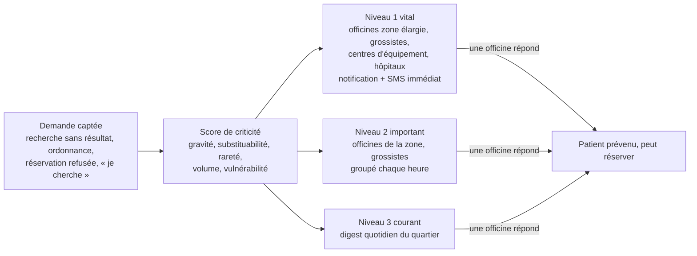
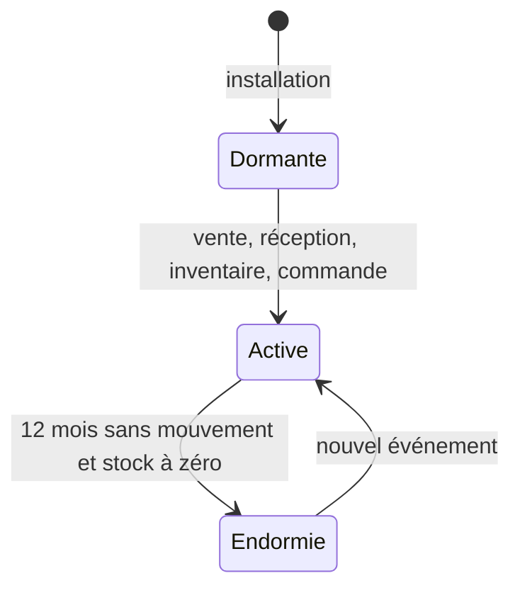

<!-- VisionPharma · documentation projet · v3.1 · 2026-10-26 -->

# Partie III — Fonctionnalités avancées et innovations

Produits introuvables et alertes par criticité, catalogue dormant préchargé, rapports détaillés pour le pharmacien, et un catalogue de fonctionnalités innovantes avec leur impact sur l'architecture.

## 26. Produits introuvables et alertes par criticité

Chaque fois qu'un patient ne trouve pas un médicament ou un dispositif médical, VisionPharma capte la demande, mesure sa criticité, puis prévient les officines, grossistes et centres d'équipement médical capables d'y répondre. Une recherche qui échoue n'est plus perdue : elle devient un signal.

*Figure 7 — Circuit d'une demande non satisfaite*

### 26.1 Ce qui déclenche une demande non satisfaite

| **Déclencheur**                                         | **Canal**                     | **Ce qui est enregistré**                             |
|---------------------------------------------------------|-------------------------------|-------------------------------------------------------|
| Recherche sans officine disponible dans le rayon choisi | App, WhatsApp, USSD           | Produit, zone, heure, nombre de patients distincts    |
| Ligne d'ordonnance introuvable après lecture            | App, WhatsApp, nœud pharmacie | Produit prescrit, dosage, contexte de soin si indiqué |
| Réservation refusée pour rupture                        | Nœud pharmacie                | Produit, officine, raison du refus                    |
| Demande explicite « je cherche »                        | App, WhatsApp, hotline        | Produit ou dispositif, urgence déclarée, date limite  |
| Rupture déclarée par une officine ou un dispensaire     | Nœud, module dispensaire      | Produit, durée de rupture, alternatives proposées     |

### 26.2 Le score de criticité

Chaque demande reçoit un score qui combine cinq critères. La pondération initiale ci-dessous est une proposition : elle doit être validée par un comité de pharmaciens et révisée après le pilote.

| **Critère**                       | **Question posée**                                            | **Poids proposé** | **Exemples de valeur haute**                                                                         |
|-----------------------------------|---------------------------------------------------------------|-------------------|------------------------------------------------------------------------------------------------------|
| Gravité thérapeutique             | Que se passe-t-il si le patient n'a pas le produit ?          | 35 %              | Insuline, antiépileptiques, anticoagulants, antirétroviraux, ocytocine, sérum antitétanique, oxygène |
| Substituabilité                   | Existe-t-il un équivalent disponible (même DCI, même forme) ? | 20 %              | Aucun générique, forme pédiatrique spécifique                                                        |
| Rareté locale                     | Combien d'officines de la zone l'ont en stock ?               | 20 %              | Aucune officine à moins de 10 km                                                                     |
| Volume de demande                 | Combien de patients distincts le cherchent ?                  | 15 %              | Plus de 5 demandes en 24 heures dans un district                                                     |
| Vulnérabilité et contexte de soin | Enfant, femme enceinte, procédure programmée ?                | 10 %              | Chirurgie prévue, dialyse, accouchement                                                              |

Le score classe la demande en trois niveaux. La gravité thérapeutique s'appuie sur une classification interne dérivée de la liste nationale des médicaments essentiels et de la liste modèle de l'OMS, enrichie pour les dispositifs médicaux.

| **Niveau**        | **Signification**                     | **Destinataires**                                                                         | **Canal**                                                     | **Délai**         |
|-------------------|---------------------------------------|-------------------------------------------------------------------------------------------|---------------------------------------------------------------|-------------------|
| **1 · Vital**     | Risque grave ou décès sans le produit | Officines en zone élargie, grossistes, centres d'équipement médical, hôpitaux partenaires | Notification prioritaire dans le logiciel et SMS au titulaire | Immédiat          |
| **2 · Important** | Traitement compromis ou retardé       | Officines de la zone, grossistes concernés                                                | Notification groupée dans le logiciel                         | Toutes les heures |
| **3 · Courant**   | Confort, alternative possible         | Officines du quartier                                                                     | Digest « demande du quartier » et suggestion de commande      | Une fois par jour |

### 26.3 Ce que voit la pharmacie

La notification arrive dans le logiciel de l'officine, avec ce qu'il faut pour agir en un clic :

- **Le message** : « 3 patients cherchent de l'insuline glargine à moins de 2 km depuis ce matin. Niveau 1. »

- **Le contexte** : votre stock (y compris dormant), le grossiste qui l'a, son délai, votre dernier prix de vente.

- **Les actions** : « Je l'ai » (corrige un stock mal saisi), « Je peux l'obtenir sous 24 h », « Ajouter à ma commande », « Pas disponible ».

- **Le retour au patient** : dès qu'une officine répond positivement, chaque patient en attente est prévenu par son canal et peut réserver.

Les grossistes reçoivent la même alerte, agrégée par zone, dans leur espace Connect. Ils peuvent signaler un réapprovisionnement, une rupture chez le fabricant ou une livraison prioritaire.

### 26.4 Centres d'équipement médical et dispositifs

Le même mécanisme couvre le matériel médical : un nouveau type de partenaire, les centres et magasins d'équipement médical, rejoint VisionPharma Connect.

| **Catégorie**             | **Exemples**                                                     | **Particularités**                            |
|---------------------------|------------------------------------------------------------------|-----------------------------------------------|
| Diagnostic à domicile     | Glucomètres, bandelettes, tensiomètres, oxymètres                | Consommables récurrents : abonnement possible |
| Assistance respiratoire   | Concentrateurs et bouteilles d'oxygène, nébuliseurs              | Souvent vital ; location fréquente            |
| Mobilité                  | Fauteuils roulants, déambulateurs, béquilles                     | Location ou achat                             |
| Consommables de soin      | Pansements spéciaux, sondes, poches de stomie, kits de perfusion | Liés à une procédure de soin                  |
| Équipement de dispensaire | Petits équipements, kits obstétricaux                            | Commandés par les dispensaires et ONG         |

Les centres d'équipement disposent d'un espace Connect : catalogue de leurs produits, disponibilités, tarifs de location et d'achat, réception des alertes et des réservations.

### 26.5 Garde-fous

- **Anonymat** : l'alerte porte sur le produit, la zone et le nombre de demandes, jamais sur l'identité du patient.

- **Produits sensibles** : les produits à risque de détournement (certains opioïdes et psychotropes) ne sont jamais diffusés en alerte publique ; ils ne circulent qu'entre professionnels authentifiés.

- **Anti-abus** : limite de demandes par numéro, détection des demandes répétées artificielles.

- **Pas de surenchère** : si une officine affiche un prix très supérieur au prix médian de la zone, le patient voit l'écart et l'Observatoire le signale.

- **Validation pharmaceutique** : aucune alternative n'est proposée au patient sans passer par un pharmacien.

**Liaison avec l'Observatoire** : la carte de la demande non satisfaite par produit et par district est l'indicateur de rupture le plus précoce du système. Une demande de niveau 1 qui reste sans réponse plus de 24 heures dans plusieurs districts déclenche un signal vers la DPML et les ONG concernées.

## 27. Catalogue dormant préchargé

À l'installation, chaque officine reçoit le référentiel complet, soit des dizaines de milliers de références, en état « dormant ». Une référence ne devient une ligne de stock qu'au premier événement réel. L'installation prend une journée au lieu de semaines de saisie.

*Figure 8 — Cycle de vie d'une référence du catalogue*

### 27.1 Contenu du catalogue

- **Médicaments** : nom commercial, DCI, dosage, forme, présentation, code-barres GTIN, statut d'autorisation, liste (ordonnance ou non), conditions de conservation, équivalents génériques.

- **Parapharmacie et hygiène**, avec catégories et prix conseillés.

- **Dispositifs médicaux et consommables.**

- **Pour chaque fiche** : prix conseillé ou homologué s'il existe, grossistes qui la référencent, niveau de criticité, image basse définition téléchargée à la demande.

*Taille cible à confirmer avec les grossistes et la DPML : de l'ordre de 20 000 à 50 000 références au lancement.*

### 27.2 Règles d'activation

| **Événement**                                    | **Effet sur la référence**                                                                         |
|--------------------------------------------------|----------------------------------------------------------------------------------------------------|
| Scan en caisse d'un code-barres inconnu du stock | La fiche dormante s'active, le prix conseillé est proposé, le caissier saisit la quantité en rayon |
| Réception d'une commande                         | Activation avec lot, date de péremption et prix d'achat                                            |
| Inventaire                                       | Activation avec la quantité comptée                                                                |
| Commande passée                                  | Activation en statut « attendu », sans stock                                                       |
| Simple recherche                                 | Pas d'activation ; la recherche est comptée dans la demande du quartier                            |
| 12 mois sans mouvement et stock à zéro           | Passage en « endormie » : la fiche sort des listes, l'historique reste                             |

**Vente sans stock enregistré** : pendant la période de démarrage, une vente peut être faite sur une référence activée à la volée. Elle est marquée « stock à régulariser » et apparaît dans le rapport quotidien du titulaire. Le démarrage n'est jamais bloqué.

### 27.3 Ce que ça apporte

- **Installation en une journée** : aucune fiche produit à créer à la main.

- **Données propres et comparables** : toutes les officines parlent le même référentiel, ce qui rend possibles l'Observatoire, la comparaison des prix et les alertes.

- **Recherche immédiate** : le caissier trouve n'importe quel produit, même jamais vendu dans l'officine.

- **Mises à jour automatiques** : un nouveau produit autorisé ou un rappel arrive dans toutes les officines sans saisie.

- **Produits sans code-barres** : le logiciel imprime une étiquette interne liée à la fiche.

### 27.4 Système

- Le catalogue complet est stocké localement sur le nœud, indexé pour une recherche instantanée, séparé de la table de stock.

- Les mises à jour arrivent en différentiel quotidien versionné ; un rappel passe en priorité.

- Les images sont téléchargées à la demande et gardées en cache pour ne pas alourdir l'installation.

- Une fiche créée localement (produit absent du référentiel) est remontée au back-office pour validation et intégration au référentiel commun.

## 28. Rapports détaillés pour le pharmacien

Le logiciel produit des rapports réguliers, rédigés en langage clair à partir des chiffres de l'officine. Chacun commence par ce qu'il faut retenir et trois actions recommandées. L'IA rédige ; les chiffres sont calculés par le système et chaque phrase renvoie à sa source.

| **Rapport**            | **Fréquence**             | **Contenu**                                                                                           | **À quoi il sert**                         |
|------------------------|---------------------------|-------------------------------------------------------------------------------------------------------|--------------------------------------------|
| Clôture de caisse      | Quotidienne               | Ventes par mode de paiement, écarts de caisse, annulations, ventes « stock à régulariser »            | Contrôle et lutte contre la fraude interne |
| Activité de la semaine | Hebdomadaire              | Meilleures ventes, ruptures, demande non satisfaite du quartier, réservations perdues                 | Ajuster les commandes                      |
| Péremptions            | Hebdomadaire              | Produits à 90, 60 et 30 jours, valeur à risque, actions suggérées (retour, échange réseau, promotion) | Réduire les pertes sèches                  |
| Performance            | Mensuelle                 | Chiffre d'affaires, marge par famille, rotation, panier moyen, comparaison anonyme avec le réseau     | Piloter la rentabilité                     |
| Stock immobilisé       | Mensuelle                 | Produits sans vente depuis 90 jours, capital immobilisé, suggestions de déstockage                    | Libérer de la trésorerie                   |
| Fournisseurs           | Mensuelle                 | Taux de service par grossiste, délais, ruptures fournisseur, écarts de prix                           | Négocier et choisir                        |
| Conformité             | Mensuelle et à la demande | Ventes liées à une ordonnance, produits sensibles, rappels traités, journal d'accès                   | Préparer une inspection                    |
| Tiers payant           | Mensuelle                 | Créances par assureur, ancienneté, rejets et motifs                                                   | Récupérer son argent                       |
| Patients chroniques    | Hebdomadaire              | Renouvellements à venir, patients qui ne sont pas revenus (avec consentement)                         | Fidéliser et soigner                       |
| Équipe                 | Mensuelle                 | Ventes, annulations et remises par employé                                                            | Gestion du personnel                       |
| Export comptable       | Mensuelle                 | Journal des ventes et achats au format de l'expert-comptable                                          | Comptabilité et fiscalité                  |

### 28.1 Comment les rapports sont livrés

- **Dans le logiciel** : tableau de bord interactif, avec chaque chiffre cliquable jusqu'aux ventes concernées.

- **En PDF** : version imprimable, signable, archivée pour les inspections.

- **Sur WhatsApp** : un résumé de 5 lignes chaque matin pour le titulaire.

- **En question libre** : « Combien ai-je perdu en périmés ce trimestre ? » ; la réponse cite les chiffres et les produits.

### 28.2 Garde-fous

- Les chiffres viennent de requêtes vérifiables, jamais d'une estimation du modèle.

- Aucune donnée d'une autre officine n'apparaît, sauf des agrégats anonymes du réseau.

- Les recommandations sont des suggestions ; le titulaire décide.

## 29. Autres fonctionnalités innovantes

Voici vingt-six fonctionnalités supplémentaires, regroupées par bénéficiaire. Chacune s'appuie sur des briques déjà prévues : le référentiel, les événements, le portail Connect et les canaux patient.

### 29.1 Pour les officines

| **Fonctionnalité**                 | **Ce que ça fait**                                                                                                                                           | **Priorité** |
|------------------------------------|--------------------------------------------------------------------------------------------------------------------------------------------------------------|--------------|
| Dépannage confraternel             | Une officine demande une boîte en urgence à une voisine du réseau ; le transfert est tracé dans les deux stocks                                              | V2           |
| Bourse d'échange des péremptions   | Les produits proches de la péremption sont proposés aux officines qui les vendent plus vite                                                                  | V2           |
| Garde automatique                  | Quand l'officine est de garde, le logiciel publie son statut, ouvre la file de réservations de nuit et prévient les patients en attente                      | MVP          |
| Surveillance de la chaîne du froid | Un capteur de température bon marché dans le réfrigérateur alerte en cas de rupture du froid (vaccins, insulines) et garde l'historique pour les inspections | V2           |
| Reconnaissance visuelle de boîte   | Une photo de la boîte retrouve la fiche du catalogue quand le code-barres est abîmé ou absent                                                                | V2           |
| Commande saisonnière               | Prévision renforcée avant la saison des pluies (antipaludiques, sels de réhydratation)                                                                       | V2           |
| Détection de fraude interne        | Alerte sur les annulations suspectes, les ventes hors horaires et les écarts de caisse répétés                                                               | MVP          |
| Financement de stock               | Crédit fournisseur ou avance sur créances de tiers payant, accordés par une banque ou un EMF partenaire à partir de l'historique de ventes                   | V2           |
| Formation continue                 | Micro-modules de quelques minutes : nouveaux produits, rappels, bonnes pratiques de dispensation                                                             | V3           |

### 29.2 Pour les patients

| **Fonctionnalité**                     | **Ce que ça fait**                                                                                                    | **Priorité** |
|----------------------------------------|-----------------------------------------------------------------------------------------------------------------------|--------------|
| Alerte « de retour en stock »          | Le patient s'abonne à un produit introuvable et est prévenu dès qu'une officine proche l'a                            | MVP          |
| Abonnement maladies chroniques         | Renouvellement réservé automatiquement avant la fin du traitement (diabète, hypertension, VIH)                        | V2           |
| Étiquette de posologie en pictogrammes | L'officine imprime une étiquette illustrée (matin, midi, soir, avant ou après repas) pour les patients qui lisent peu | V2           |
| Rappel de prise par appel vocal        | Un appel automatisé en français, anglais ou pidgin rappelle la prise, pour les téléphones sans smartphone             | V3           |
| Vérification de la boîte               | Photo de la boîte et du numéro de lot : le système vérifie le référentiel et la liste des rappels                     | V2           |
| Paiement par un proche                 | Un proche, y compris de la diaspora, paie le traitement directement à l'officine (pont avec KÓMBE Send)               | V2           |
| Épargne et tontine santé               | Cotisation régulière qui finance les médicaments de la famille (pont avec KÓMBE)                                      | V3           |
| Budget santé familial                  | Historique des dépenses de pharmacie de la famille, justificatifs pour employeur ou assureur                          | V2           |
| Signalement d'effet indésirable        | Un formulaire simple transmis à la pharmacovigilance de la DPML                                                       | V2           |

### 29.3 Pour l'État, les ONG et le système de santé

| **Fonctionnalité**                    | **Ce que ça fait**                                                                                                                  | **Priorité** |
|---------------------------------------|-------------------------------------------------------------------------------------------------------------------------------------|--------------|
| Réserve stratégique virtuelle         | En cas d'épidémie ou de catastrophe, vue en temps réel du stock de produits vitaux dans le réseau, par district                     | V2           |
| Collecte des médicaments non utilisés | Les patients rapportent leurs restes en officine ; la collecte et la destruction sont tracées, ce qui limite la revente dans la rue | V3           |
| Carte de la demande non satisfaite    | Publication mensuelle, par district, des produits les plus recherchés et introuvables                                               | V2           |
| Pharmacovigilance assistée            | Regroupement des signalements par produit et par lot, alerte si un lot concentre les plaintes                                       | V2           |
| Pont avec la CSU                      | Vérification des droits CSU en caisse et facturation électronique au programme                                                      | V3           |

### 29.4 Pour les fournisseurs et centres d'équipement

| **Fonctionnalité**           | **Ce que ça fait**                                                                                | **Priorité** |
|------------------------------|---------------------------------------------------------------------------------------------------|--------------|
| Commandes groupées           | Plusieurs officines se regroupent sur une commande pour obtenir un meilleur prix ou une livraison | V2           |
| Rappel de lot ciblé          | Le laboratoire voit exactement quelles officines ont reçu le lot et lesquelles l'ont bloqué       | V2           |
| Location de matériel médical | Réservation et suivi des locations (oxygène, fauteuils) avec caution en Mobile Money              | V3           |

### 29.5 Ce qui entre dans le MVP

Pour garder le pilote réalisable, seules cinq de ces nouveautés entrent dans le MVP : elles sont simples à construire et augmentent directement l'adoption.

1.  **Le catalogue dormant préchargé** (lot 1 et lot 2) : sans lui, l'installation prend trop de temps.

2.  **La capture de la demande non satisfaite**, avec une version simple du score (gravité et rareté) et la notification aux officines de la zone (lot 5).

> **Mise à jour v3.0** : dans le MVP autonome (L0), seule la **capture** au comptoir est construite (exigences D-01 à D-03). Le score complet, la notification des autres officines et l'alerte « de retour en stock » demandent le cœur de données et arrivent avec L1 et L2. La garde automatique et la détection de fraude de base restent dans L0 (G-01, P-08).

3.  **L'alerte « de retour en stock »** pour le patient (lot 5).

4.  **Les rapports de clôture de caisse et de péremptions** (lot 3).

5.  **La garde automatique et la détection de fraude interne de base** (lot 2).

## 30. Impact sur les composants et les liaisons

Ces fonctionnalités s'ajoutent aux composants existants sans en créer de nouveaux, sauf un type de partenaire : les centres d'équipement médical.

| **Composant**        | **Ce qui change**                                                                                                                                |
|----------------------|--------------------------------------------------------------------------------------------------------------------------------------------------|
| Nœud pharmacie       | Catalogue dormant local, centre de notifications avec actions rapides, générateur de rapports, garde automatique, capteur de froid (V2)          |
| Cœur de données      | Nouveau service « demande et criticité » : capture, score, routage des alertes, suivi des réponses ; référentiel étendu aux dispositifs médicaux |
| Canaux patient       | Bouton « je cherche », abonnement au retour en stock, suivi de la demande, vérification de boîte (V2)                                            |
| VisionPharma Connect | Espace « centres d'équipement médical », alertes agrégées pour les grossistes, API de location (V3)                                              |
| Observatoire         | Carte de la demande non satisfaite, réserve stratégique virtuelle, signaux de pharmacovigilance                                                  |
| Back-office          | Comité de criticité (gestion des niveaux par produit), liste des produits sensibles, validation des fiches créées localement                     |
| Couche IA            | Rédaction des rapports, reconnaissance visuelle de boîte, détection de fraude, prévision saisonnière                                             |

### 30.1 Nouveaux événements

| **Événement**                                 | **Émis par**         | **Consommé par**                                  |
|-----------------------------------------------|----------------------|---------------------------------------------------|
| demand.unmet                                  | Canaux patient, nœud | Service de criticité, Observatoire                |
| demand.alert_sent                             | Service de criticité | Nœuds, Connect (grossistes, centres d'équipement) |
| demand.answered                               | Nœud, Connect        | Canaux patient, Observatoire                      |
| catalog.item_activated ; catalog.item_dormant | Nœud                 | Cœur                                              |
| catalog.local_item_created                    | Nœud                 | Back-office                                       |
| report.generated                              | Nœud                 | Titulaire (WhatsApp, PDF)                         |
| coldchain.breach                              | Capteur via le nœud  | Titulaire, back-office                            |
| adverse_event.reported                        | Canaux patient, nœud | Back-office, DPML via Connect                     |
