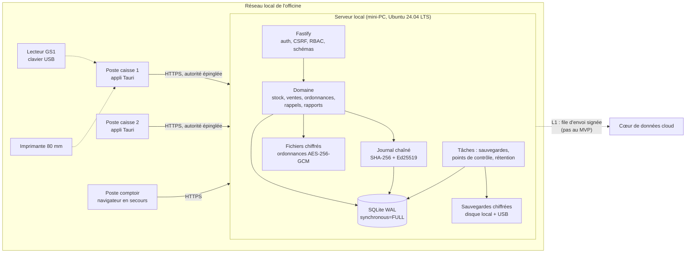
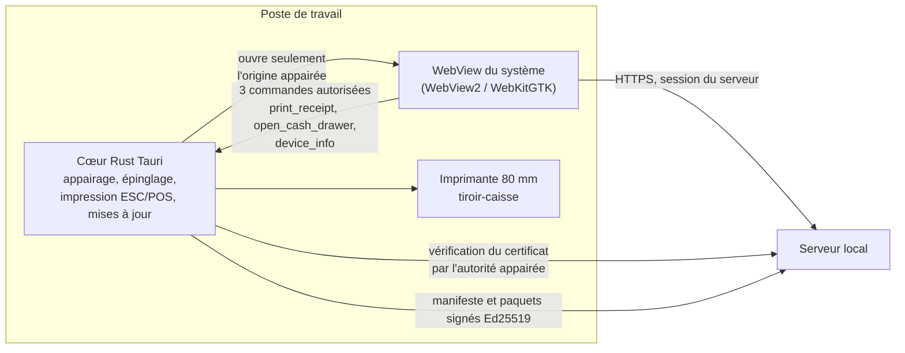

<!-- VisionPharma · documentation projet · v3.1 · 2026-10-26 -->

# Architecture technique et sécurité — VisionPharma Officine

Ce document précise **comment** le nœud pharmacie est construit et protégé. Les exigences qu'il réalise sont dans [04-cahier-des-charges.md](04-cahier-des-charges.md) (préfixes SEC-, NFR-) et [05-mvp-officine-spec.md](05-mvp-officine-spec.md).

---

## 1. Vue d'ensemble du nœud



**Couches, de l'extérieur vers l'intérieur :**

1. **HTTP** (`http/`) : TLS, en-têtes de sécurité, authentification, CSRF, validation des schémas, permission de la route. Aucune règle métier.
2. **Domaine** (`domain/`) : fonctions pures qui reçoivent une transaction et un contexte (`actor`, `now`, `register`). Toutes les règles métier et tous les invariants sont ici.
3. **Persistance** (`db/`) : ouverture, pragmas, migrations. Les requêtes SQL sont toutes paramétrées.
4. **Journal** (`domain/ledger.ts`) : seul module qui écrit dans `events` et `checkpoints`.

**Règle de transaction** : toute commande métier s'exécute dans `db.transaction(...).immediate()`. Elle modifie les tables, puis appelle `ledger.append(tx, event)` **avant** la validation. Si quoi que ce soit échoue, rien n'est écrit.

---

## 2. Modèle de menaces (STRIDE)

| Menace | Exemple dans une officine | Mesures |
|---|---|---|
| **Usurpation** | Un caissier utilise le compte du pharmacien pour valider une ordonnance | Mots de passe individuels forts, TOTP pour les rôles sensibles, ré-authentification sur les actions critiques, verrouillage de session à l'inactivité |
| **Altération** | Modifier une vente ou un stock directement dans la base pour masquer un vol | Tables en ajout seul (déclencheurs), journal chaîné SHA-256, points de contrôle signés, vérification des projections ; à partir de L1, ancrage dans un journal de transparence externe |
| **Répudiation** | « Ce n'est pas moi qui ai annulé cette vente » | Acteur authentifié sur chaque événement, ré-authentification horodatée, points de contrôle signés |
| **Divulgation** | Vol du mini-PC ou d'un disque de sauvegarde ; lecture d'une ordonnance par un caissier | Chiffrement des ordonnances et des sauvegardes (AES-256-GCM), chiffrement du disque (LUKS2, déverrouillage par TPM), droits par rôle, TLS sur le réseau local |
| **Déni de service** | Coupure de courant, disque plein, saturation par un poste | Onduleur, WAL et `synchronous=FULL`, alertes d'espace disque, limitation de débit, sauvegardes |
| **Élévation de privilège** | Appel direct d'une route d'administration depuis un poste de caisse | Refus par défaut, permission déclarée sur chaque route, test exhaustif de la matrice, aucune donnée de rôle venant du client |

**Menaces propres au contexte :**
- **Collusion interne** (vente de lots rappelés, détournement de produits sensibles) : registre des produits sensibles, rappels bloquants, rapport de fraude, journal infalsifiable.
- **Machine partagée ou non mise à jour** : aucune donnée métier stockée sur le poste, cookie `SameSite=Strict`, application de bureau qui ne parle qu'au serveur appairé.
- **Faux serveur sur le Wi-Fi** (pour capter des mots de passe) : l'application de bureau épingle l'autorité locale et refuse tout autre serveur (W-03).
- **Application ou mise à jour piégée** : installateurs signés, mises à jour signées en Ed25519 et servies par le serveur local (W-07).
- **Support à distance malveillant** : aucun accès sans autorisation explicite et limitée dans le temps du titulaire, tracée dans le journal.

---

## 3. Journal chaîné : spécification

### 3.1 Pourquoi pas une blockchain publique

Les propriétés recherchées sont celles d'un registre distribué : ajout seul, falsification détectable, non-répudiation, auditabilité par un tiers. Elles sont obtenues ici par trois mécanismes standard, sans consensus ni jeton :

1. une **chaîne de hachage** locale (chaque événement scelle le précédent) ;
2. des **points de contrôle signés** par la clé du nœud ;
3. à partir de L1, un **journal de transparence** en arbre de Merkle (RFC 9162) dans le cloud, qui reçoit les points de contrôle de toutes les officines. Un tiers (l'Ordre, un auditeur) peut y vérifier qu'aucune officine n'a réécrit son histoire.

Une chaîne publique exposerait des métadonnées de santé et dépendrait du réseau, avec un coût par transaction. Elle n'apporterait rien de plus pour des acteurs identifiés.

### 3.2 Structure d'un événement

| Champ | Type | Règle |
|---|---|---|
| `seq` | entier | 1, 2, 3… sans trou, attribué dans la transaction |
| `id` | UUID v4 | Unique ; sert d'identifiant CloudEvents et de clé d'idempotence |
| `type` | texte | Notation pointée, par exemple `sale.completed` (liste à l'annexe C) |
| `at` | texte ISO 8601 UTC, millisecondes | Heure du serveur |
| `actor` | texte ou `null` | Identifiant de l'utilisateur ; `null` pour le système |
| `payload` | objet JSON | Données métier ; jamais de secret, jamais d'image |
| `prev_hash` | 64 caractères hexadécimaux | `hash` de `seq − 1`, ou 64 zéros pour `seq = 1` |
| `hash` | 64 caractères hexadécimaux | Voir 3.3 |

### 3.3 Calcul de l'empreinte

```
hash = hex( SHA-256( UTF-8( JCS( { seq, id, type, at, actor, payload, prev_hash } ) ) ) )
```

- **JCS** : JSON Canonicalization Scheme, RFC 8785. Les clés sont triées par ordre lexicographique des points de code UTF-16, sans espaces ; les nombres suivent la sérialisation ECMAScript. Les montants sont des entiers, donc aucun problème de flottants.
- Le champ `hash` lui-même n'entre pas dans le calcul.
- Les vecteurs de test officiels sont dans [annexes/C-evenements.md](../annexes/C-evenements.md), section 4. **L'implémentation doit les reproduire à l'identique.**

### 3.4 Points de contrôle

```
message   = "VPCKPT1|" + node_id + "|" + seq + "|" + hash
signature = base64url( Ed25519.sign( node_private_key, UTF-8(message) ) )
```

- Créés tous les 100 événements, à chaque clôture de caisse et chaque jour à 00:00 heure locale.
- Stockés dans `checkpoints` (ajout seul) avec `kid`, l'identifiant de la clé.
- La clé publique du nœud et son `kid` sont affichés dans l'écran Système. Ils seront enregistrés dans le cloud à l'enrôlement (L1).

### 3.5 Vérification

La commande `verify-ledger` (et l'écran Système) :

1. parcourt `events` par `seq` croissant et vérifie qu'il n'y a pas de trou ;
2. recalcule chaque `hash` et le compare, puis vérifie que `prev_hash` est égal au `hash` précédent ;
3. vérifie la signature de chaque point de contrôle et que son `hash` est égal à celui de l'événement `seq` ;
4. recalcule le stock de chaque lot à partir des événements `stock.*`, `sale.*` et `reception.*`, et le compare à la vue `lot_stock` ;
5. recalcule les totaux de chaque session de caisse et les compare à la table ;
6. renvoie `ok`, ou le premier `seq` en défaut avec le type de défaut (`gap`, `hash_mismatch`, `chain_break`, `bad_signature`, `projection_mismatch`).

**Coût visé** : 1 million d'événements vérifiés en moins de 60 secondes sur le matériel de référence.

### 3.6 Ce que le journal garantit, et ses limites

| Garantie | Niveau |
|---|---|
| Modification ou suppression d'un événement passé | Détectée par la vérification locale |
| Réécriture complète de la chaîne avec recalcul des empreintes | Détectée par les signatures, sauf si la clé privée du nœud est aussi volée |
| Réécriture avec la clé du nœud volée | Détectée à partir de L1, par comparaison avec les points de contrôle déjà ancrés dans le journal de transparence du cloud |
| Événements jamais écrits (fraude « hors système ») | Non détectable par le journal ; couverte par l'inventaire, les rapports de fraude et les contrôles |

Pour cette raison, la clé privée Ed25519 est stockée avec des droits 0600, sur un disque chiffré. À partir de L1, elle pourra être déplacée dans un TPM 2.0 si le matériel le permet.

---

## 4. Cryptographie et gestion des clés

### 4.1 Profil cryptographique

| Usage | Primitive | Paramètres |
|---|---|---|
| Transport | TLS 1.3, TLS 1.2 minimum | Suites AEAD uniquement ; autorité de certification locale ECDSA P-256 (10 ans) générée à l'installation, qui signe le certificat du serveur (2 ans) |
| Mises à jour de l'application de bureau | Ed25519 (mécanisme du plugin updater de Tauri) | Clé de signature conservée hors du dépôt, dans le coffre de la CI |
| Mots de passe | scrypt | N = 2^17, r = 8, p = 1, sel de 16 octets, sortie de 32 octets |
| Chiffrement de fichiers et de sauvegardes | AES-256-GCM | Nonce aléatoire de 96 bits par chiffrement, étiquette de 128 bits, données associées = en-tête |
| Dérivation de clés | HKDF-SHA-256 (RFC 5869) | Clé de sauvegarde = HKDF(clé de données, info = "vp-backup-v1") ; clé de fichiers = HKDF(clé de données, "vp-blob-v1") |
| Clé de récupération | scrypt puis AES-256-GCM | Secret de 32 octets affiché en base32 à l'installation ; il chiffre une copie de la clé de données |
| Empreintes | SHA-256 | Journal, jetons de session, intégrité |
| Signatures | Ed25519 | Points de contrôle du journal |
| TOTP | HMAC-SHA-1, 6 chiffres, 30 secondes | Conforme RFC 6238 et compatible avec les applications courantes ; secret chiffré en base avec la clé de données |
| Aléatoire | `crypto.randomBytes` | Toujours ; jamais `Math.random` |

### 4.2 Fichiers de clés

| Fichier | Contenu | Droits |
|---|---|---|
| `keys/data.key` | Clé de données AES-256 (32 octets) | 0600, propriétaire `vpofficine` |
| `keys/recovery.wrap` | Clé de données chiffrée par la clé de récupération | 0600 |
| `keys/node_ed25519.pem` | Clé privée du nœud (PKCS#8) | 0600 |
| `keys/node_ed25519.pub.pem` | Clé publique | 0644 |
| `keys/node.json` | `node_id`, `kid` des clés, date de création | 0600 |
| `tls/ca.key.pem`, `tls/ca.pem` | Autorité de certification locale | 0600 et 0644 |
| `tls/key.pem`, `tls/cert.pem` | Clé et certificat TLS du serveur | 0600 et 0644 |

Le répertoire de données est hors de la racine servie par HTTP. Le serveur refuse de démarrer si les droits des fichiers de clés sont trop ouverts.

### 4.3 Format d'archive de sauvegarde

```
"VPBAK1"                 6 octets
longueur de l'en-tête    4 octets, big-endian
en-tête JSON (en clair, authentifié comme données associées) :
  { "v":1, "node_id":…, "created_at":…, "last_seq":…, "last_hash":…,
    "kid":…, "nonce":"base64url", "recovery_wrap":"base64url", "recovery_salt":"base64url" }
contenu chiffré          AES-256-GCM(clé de sauvegarde, nonce, données associées = en-tête)
                         = archive tar de { officine.db, blobs/, keys/node_ed25519.pem, keys/node.json }
étiquette GCM            16 octets
```

À la restauration sur la même machine, la clé de sauvegarde vient de `data.key`. Sur une nouvelle machine, la clé de données est récupérée depuis `recovery_wrap` avec la clé de récupération.

### 4.4 Rotation

- **Clé TLS** : renouvelée tous les 2 ans, ou à la demande.
- **Clé de données** : rotation possible ; les nouveaux fichiers utilisent le nouveau `kid`, les anciens sont rechiffrés par une tâche de fond.
- **Clé du nœud** : rotation par un événement `system.key_rotated` signé par l'ancienne clé et la nouvelle.

### 4.5 Post-quantique

Les signatures Ed25519 et les échanges ECDH ne résisteront pas à un ordinateur quantique. Le risque pour un journal de transactions est la falsification **future** de signatures **passées**. Le plan :

1. Chaque élément porte un identifiant d'algorithme (`alg`) : aucune hypothèse codée en dur.
2. Dès que l'environnement d'exécution le permet, les points de contrôle sont **doublés** par une signature ML-DSA (FIPS 204).
3. L'ancrage dans le journal de transparence (L1) et l'horodatage RFC 3161 limitent le risque, car un point de contrôle déjà publié ne peut plus être remplacé sans être détecté.

---

## 5. Sécurité réseau et système

| Domaine | Mesure |
|---|---|
| Pare-feu | `ufw` : seul le port HTTPS est ouvert, et seulement au sous-réseau local ; SSH fermé par défaut |
| Accès de support | SSH par clé uniquement, ouvert par le titulaire depuis l'écran Système pour une durée limitée (2 heures au maximum), tracé dans le journal |
| Système | Mises à jour de sécurité automatiques d'Ubuntu (`unattended-upgrades`), heure par NTP |
| Disque | LUKS2 avec déverrouillage par TPM 2.0 (`systemd-cryptenroll`) quand la machine le permet ; sinon, la phrase de passe est demandée au démarrage |
| Service | Utilisateur dédié `vpofficine`, `NoNewPrivileges`, `ProtectSystem=strict`, `ProtectHome=yes`, `PrivateTmp=yes`, accès en écriture au seul répertoire de données |
| Conteneur (option Docker) | Image distroless ou slim, utilisateur non-root, système de fichiers en lecture seule sauf le volume de données, `cap_drop: ALL` |
| Wi-Fi | WPA2 ou WPA3, réseau séparé pour les clients de l'officine |

---

## 5 bis. Application de bureau des postes (Tauri 2)



| Point | Règle |
|---|---|
| Contenu | La fenêtre affiche l'interface **servie par le serveur** ; le seul contenu embarqué est l'écran d'appairage. Une mise à jour du serveur met donc à jour l'interface de tous les postes. |
| Confiance | L'appairage enregistre l'empreinte de l'autorité locale, confirmée par un code à 8 chiffres affiché sur le serveur. Ensuite, chaque connexion est vérifiée par le cœur Rust avant l'ouverture de l'interface. |
| Pont natif | Capacités Tauri déclarées pour l'origine appairée seulement (`remote`), limitées à trois commandes. Les arguments de `print_receipt` sont validés côté Rust (taille, structure) ; l'application ne lit ni n'écrit aucun fichier en dehors de sa configuration. |
| Navigation | Toute navigation hors de l'origine appairée est bloquée ; aucun lien externe ne s'ouvre. |
| Mises à jour | Manifeste et paquets publiés par le serveur local, signés en Ed25519 ; la clé publique est compilée dans l'application. |
| Signature | Installateurs signés par Authenticode (Windows) ; la clé de signature et la clé de mise à jour vivent dans le coffre de la CI, jamais dans le dépôt. |
| Révocation | Un poste révoqué par le titulaire revient à l'écran d'appairage au contrôle suivant. |

## 6. Concurrence et fiabilité

- **SQLite en WAL** permet de lire pendant qu'on écrit. Les écritures sont sérialisées par `BEGIN IMMEDIATE`, ce qui empêche deux caisses de vendre la même dernière boîte (S-04).
- `busy_timeout` de 5 secondes ; au-delà, l'API renvoie 503 et l'interface propose de réessayer sans perdre le panier.
- `synchronous=FULL` : une vente validée survit à une coupure de courant.
- Le volume visé (10 postes, quelques milliers de ventes par jour) est très en dessous des limites de SQLite. Le passage à PostgreSQL n'est utile que pour le cloud (ADR-003).

---

## 7. Préparation du branchement au cloud (L1)

Rien de ceci n'est actif au MVP, mais le modèle de données le permet déjà :

| Élément prêt au MVP | Utilisation en L1 |
|---|---|
| UUID sur toutes les entités et événements | Dédoublonnage côté cloud |
| Enveloppe d'événement compatible CloudEvents | Envoi tel quel par la passerelle de synchronisation |
| File d'envoi (`synced_at IS NULL`) et export signé | Envoi par lots, accusé par identifiant |
| Points de contrôle signés | Ancrage dans le journal de transparence |
| `ref_code` du référentiel sur chaque fiche | Mise à jour différentielle du catalogue |
| Interface prévue (non implémentée) `RemoteCatalog`, `RecallFeed`, `SyncTransport` | Implémentations L1 |

Le protocole de synchronisation est spécifié dans [02-specifications-composants.md](02-specifications-composants.md), section 15.
